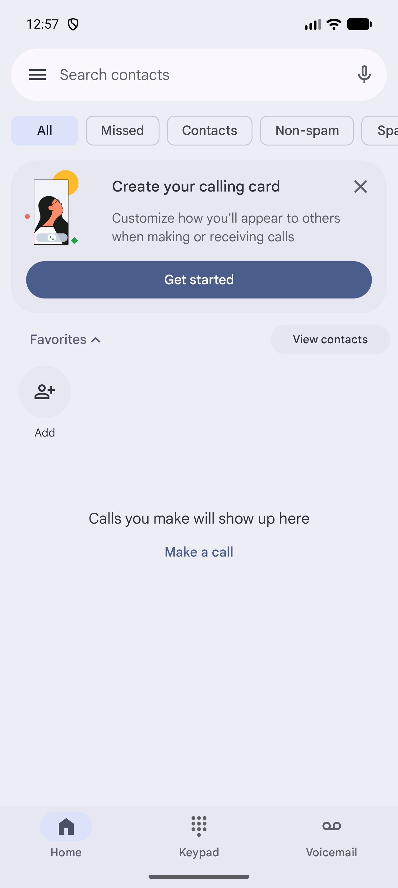
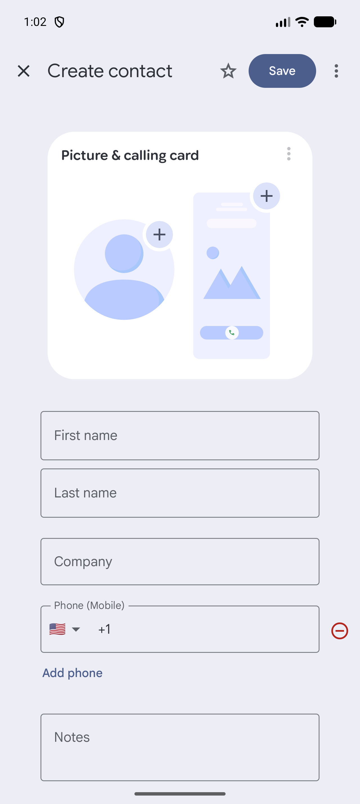
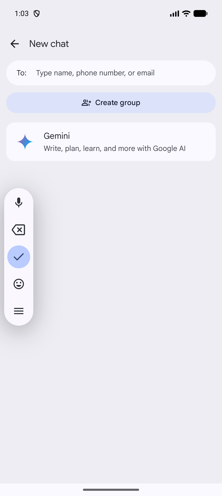
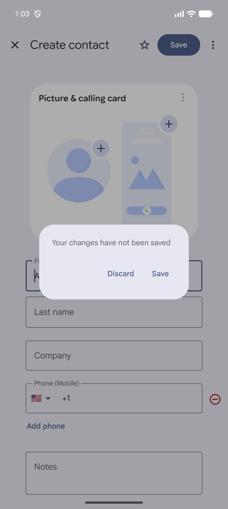

# Android forms and controls

[Observed] Evidence is limited to the directly inspected Android 17 Emulator surface described in [`../../research/notes/android/direct-observation-log.md`](../../research/notes/android/direct-observation-log.md).

## Trailing switch in a settings or list row

- **Pattern name:** [Observed] Trailing switch in a settings or list row
- **Platform:** [Observed] Android 17
- **Category:** [Observed] Controls
- **Description:** [Observed] A switch sits at the trailing edge of a labeled row or card and exposes checked state in the UI hierarchy.
- **Purpose:** [Inferred] Supports direct on/off changes without requiring a separate confirmation step.
- **Visual structure:** [Observed] Settings placed a Dark theme switch after title and summary text; Clock placed one switch on each alarm card.
- **Interaction:** [Observed] The controls were reported clickable and focusable by UI Automator; they were not toggled during this audit.
- **States:** [Observed] The inspected Settings and Clock switches were `checked="false"`; visual tracks and thumbs remained visible.
- **Variations:** [Observed] Settings paired its switch with a chevron and divider because the row also opened detail; Clock paired switches with expandable alarm cards.
- **Applications observed:** [Observed] Settings, Clock.
- **Screenshot evidence:** [Observed] , [Clock alarms](../../../../skills/native-ui-patterns/assets/android/clock/alarm-list.png)
- **Design guidance:** [Inferred] Keep the label and current state adjacent, and expose a semantic checked state.
- **Avoid:** [Inferred] Avoid changing unrelated settings when a user taps a nested detail affordance.
- **Notes:** [Observed] This recurring pattern was confirmed in two Google apps.

## Labeled chip or compact filter control

- **Pattern name:** [Observed] Labeled chip or compact filter control
- **Platform:** [Observed] Android 17
- **Category:** [Observed] Filtering controls
- **Description:** [Observed] Compact rounded controls display category or status labels.
- **Purpose:** [Inferred] Makes common filters immediately scannable and reachable.
- **Visual structure:** [Observed] Phone used All, Missed, Contacts, and Non-spam controls; Maps used category controls such as Restaurants, Hotels, Coffee, and Shopping; Files used Images, Audio, Videos, and Documents.
- **Interaction:** [Observed] UI dumps reported the Files media controls and Maps category controls as clickable; no filter was activated to avoid changing the inspected baseline.
- **States:** [Observed] Phone's All control was visually filled while neighboring controls were outlined.
- **Variations:** [Observed] Controls may represent a selected filter (Phone), a search shortcut (Maps), or a file-type category (Files).
- **Applications observed:** [Observed] Phone, Maps, Files.
- **Screenshot evidence:** [Observed] , [Maps categories](../../../../skills/native-ui-patterns/assets/android/maps/sheet-collapsed.png), [Files categories](../../../../skills/native-ui-patterns/assets/android/files/downloads-empty.png)
- **Design guidance:** [Inferred] Keep labels short, distinguish selection, and allow horizontal overflow when the set exceeds the width.
- **Avoid:** [Inferred] Avoid relying on color alone when a selected semantic state can also be exposed.
- **Notes:** [Observed] This recurring pattern was confirmed in three Google apps.

## Structured create-contact form

- **Pattern name:** [Observed] Structured create-contact form
- **Platform:** [Observed] Android 17
- **Category:** [Observed] Forms and editing
- **Description:** [Observed] Contacts presents a full-page form with close, favorite, Save, and overflow actions above grouped identity and phone fields.
- **Purpose:** [Inferred] Supports progressive entry of structured contact data while keeping the primary save action visible.
- **Visual structure:** [Observed] A top action row precedes a picture/calling-card panel and outlined fields for first name, last name, company, phone, and notes.
- **Interaction:** [Observed] Tapping First name moved focus to the field; a prior pass entered temporary text there. In the error-feedback pass, Email was added, temporary text `invalid` was entered, and focus moved to Notes without producing inline error text or error styling. Back opened the unsaved-change confirmation, and Discard returned to the empty contact list; no contact was saved.
- **States:** [Observed] Empty, focused-with-text, malformed-email-without-inline-error, unsaved-change confirmation, and returned-after-discard states were directly observed.
- **Variations:** [Observed] Add phone and Add email expose repeatable fields with trailing remove affordances.
- **Applications observed:** [Observed] Contacts only.
- **Screenshot evidence:** [Observed] , [malformed temporary email without inline feedback](../../../../skills/native-ui-patterns/assets/android/contacts/invalid-email.png), [unsaved-change confirmation](../../../../skills/native-ui-patterns/assets/android/contacts/invalid-email-discard-prompt.png), [empty list after discard](../../../../skills/native-ui-patterns/assets/android/contacts/empty-list-after-discard.png)
- **Design guidance:** [Inferred] Keep save and exit actions stable while long forms scroll, and label field purpose independently from entered values.
- **Avoid:** [Inferred] Avoid inferring save-triggered validation or successful-save behavior; Save was not pressed because it could create persistent data.
- **Notes:** [Observed] Application-specific because only Contacts was directly confirmed; save-triggered validation remained inaccessible.

## Recipient-first composition form

- **Pattern name:** [Observed] Recipient-first composition form
- **Platform:** [Observed] Android 17
- **Category:** [Observed] Forms and editing
- **Description:** [Observed] Messages opens a New chat screen centered on a “To:” recipient field before message composition becomes available.
- **Purpose:** [Inferred] Establishes a valid conversation target before exposing send behavior.
- **Visual structure:** [Observed] A back action and title sit above a wide rounded recipient field, a Create group action, and a suggested Gemini row.
- **Interaction:** [Observed] Opening Start chat focused the recipient field; entering the temporary short number “123” surfaced a “Send to 123” candidate, while temporary text `not-a-recipient` and `invalid@` did not surface an application-authored error. The candidate was not selected, the entered text was canceled with Back, and no message was sent.
- **States:** [Observed] Empty focused, populated-without-candidate, and short-number candidate states were directly observed.
- **Variations:** [Unconfirmed] Recipient tokenization, selection-time invalid-recipient errors, group composition, and send states were not inspected because selecting a candidate would cross the audit's side-effect boundary.
- **Applications observed:** [Observed] Messages only.
- **Screenshot evidence:** [Observed] , [temporary text without an application-authored error](../../../../skills/native-ui-patterns/assets/android/messages/recipient-no-match.png), [short-number candidate](../../../../skills/native-ui-patterns/assets/android/messages/recipient-short-number-candidate.png), [recipient form after cancel](../../../../skills/native-ui-patterns/assets/android/messages/empty-list-after-recipient-cancel.png)
- **Design guidance:** [Inferred] Separate destination selection from irreversible communication and make exiting available before any send action.
- **Avoid:** [Inferred] Avoid treating a displayed recipient candidate as proof that the destination is valid or reachable.
- **Notes:** [Observed] Application-specific because only Messages was directly confirmed; downstream recipient validation remained unavailable without selecting a candidate.

## Modal time picker

- **Pattern name:** [Observed] Modal time picker
- **Platform:** [Observed] Android 17
- **Category:** [Observed] Value selection
- **Description:** [Observed] Clock opens a centered time-selection dialog above a dimmed alarm list.
- **Purpose:** [Inferred] Constrains time entry to valid hour, minute, and AM/PM values.
- **Visual structure:** [Observed] Large hour and minute values, an AM/PM selector, a circular clock face, a keyboard-mode icon, and Cancel/OK actions occupy one rounded dialog.
- **Interaction:** [Observed] Tapping the alarm add button opened the picker; the mode button opened text input, where an attempted temporary hour value of `99` left the prior `09` value unchanged after focus moved to Minute. Cancel dismissed the picker without creating an alarm.
- **States:** [Observed] Graphical selection, text-input hour focus, text-input minute focus, AM/PM selection, and canceled states were directly observed; the underlying surface was dimmed while the dialog was open.
- **Variations:** [Observed] The mode button switched between the graphical clock and labeled Hour/Minute text fields.
- **Applications observed:** [Observed] Clock only.
- **Screenshot evidence:** [Observed] , [graphical mode before switching](../../../../skills/native-ui-patterns/assets/android/clock/time-picker-before-text-mode.png), [text-input mode](../../../../skills/native-ui-patterns/assets/android/clock/time-input-text-mode.png), [unchanged hour after the out-of-range attempt](../../../../skills/native-ui-patterns/assets/android/clock/time-input-invalid-hour.png), [alarm list after cancel](../../../../skills/native-ui-patterns/assets/android/clock/alarm-list-after-cancel.png)
- **Design guidance:** [Inferred] Pair constrained graphical entry with explicit cancel/confirm actions and an alternate precise-entry affordance.
- **Avoid:** [Inferred] Avoid claiming that silent input rejection supplies sufficient error feedback; no explanatory error text was observed.
- **Notes:** [Observed] Application-specific because only Clock was directly confirmed; confirmation with OK was not exercised.

## Unsaved-change confirmation

- **Pattern name:** [Observed] Unsaved-change confirmation
- **Platform:** [Observed] Android 17
- **Category:** [Observed] Safe destructive confirmation
- **Description:** [Observed] Leaving a modified but unsaved Contacts form produced a confirmation dialog stating that changes had not been saved.
- **Purpose:** [Inferred] Prevents accidental loss of in-progress edits.
- **Visual structure:** [Observed] A compact rounded dialog overlays and dims the populated form, with Discard and Save text actions.
- **Interaction:** [Observed] The dialog appeared only after a temporary first-name value was entered and Back was invoked; the audit left the screen via Home without selecting Save or Discard.
- **States:** [Observed] Modified form and confirmation-visible states were captured.
- **Variations:** [Unconfirmed] No second application was tested for the same confirmation.
- **Applications observed:** [Observed] Contacts only.
- **Screenshot evidence:** [Observed] 
- **Design guidance:** [Inferred] Name the consequence plainly and keep the destructive action distinct from the preserving action.
- **Avoid:** [Inferred] Avoid destructive execution during evidence collection when the confirmation itself is sufficient.
- **Notes:** [Observed] Application-specific because only Contacts was directly confirmed; no persistent contact was created or deleted.
