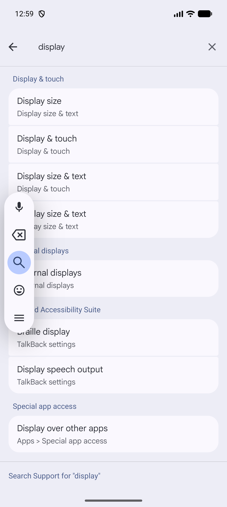
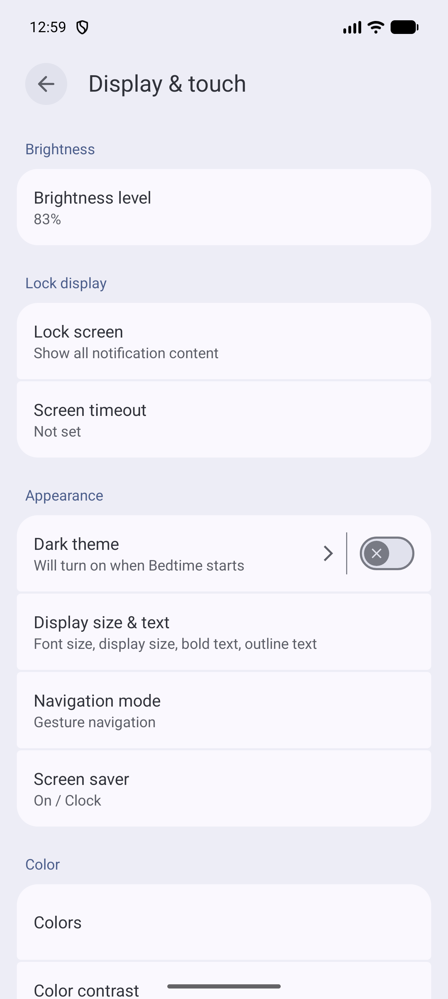
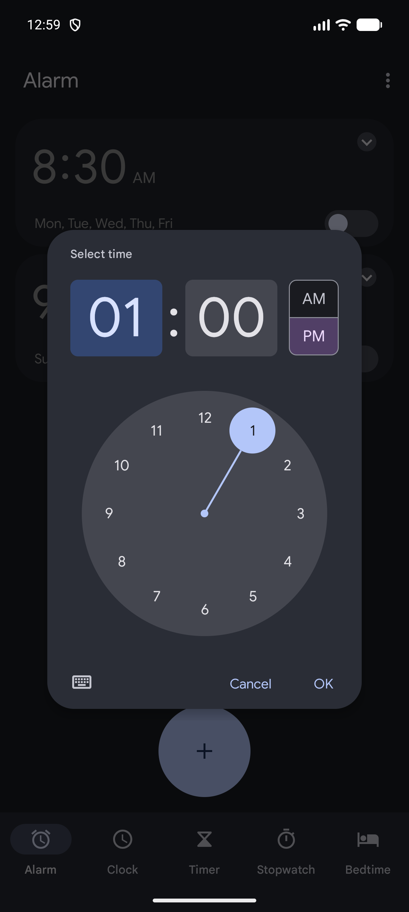
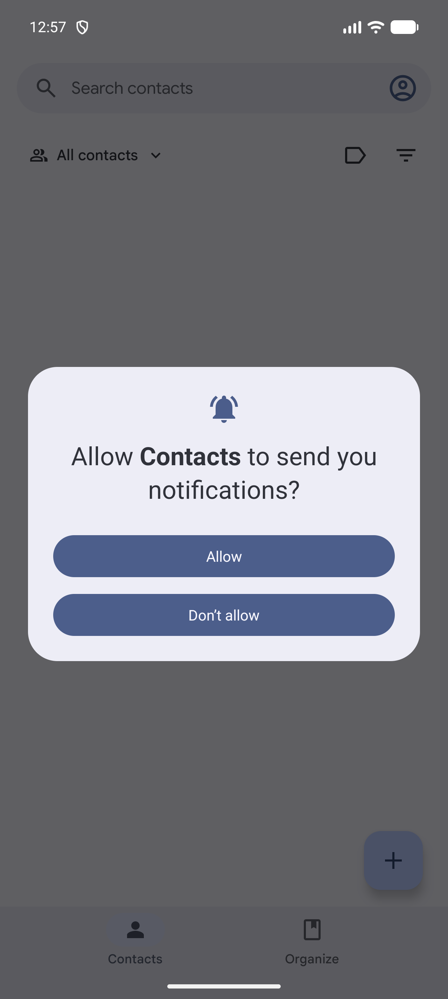

# Android interactions and accessibility

[Observed] Evidence is limited to the directly inspected Android 17 Emulator surface described in [`../../research/notes/android/direct-observation-log.md`](../../research/notes/android/direct-observation-log.md). [Observed] UI Automator dumps are preserved under [`../../research/notes/android/ui-dumps/`](../../research/notes/android/ui-dumps/).

## Search focus mode with explicit exit

- **Pattern name:** [Observed] Search focus mode with explicit exit
- **Platform:** [Observed] Android 17
- **Category:** [Observed] Keyboard and focus
- **Description:** [Observed] Entering search replaces or emphasizes the top field, adds an explicit back action, and changes the body to search-specific content.
- **Purpose:** [Inferred] Reduces distraction while preserving an obvious route back to the originating surface.
- **Visual structure:** [Observed] Settings displayed query text, a leading back arrow, a trailing clear action, and categorized results; Messages displayed a leading back arrow, a wide Search messages field, and eight search-category cards.
- **Interaction:** [Observed] ADB taps focused the fields; ADB text input populated Settings with “display”; system Back first dismissed keyboard UI and then exited search.
- **States:** [Observed] Empty focused search in Messages and populated result search in Settings were captured.
- **Variations:** [Observed] Settings showed live results; Messages showed category shortcuts before query entry.
- **Applications observed:** [Observed] Settings, Messages.
- **Screenshot evidence:** [Observed] , [Messages empty search](../../../../skills/native-ui-patterns/assets/android/messages/search-focused.png)
- **Design guidance:** [Inferred] Keep focus, exit, and clear behavior visible and make the empty search state useful.
- **Avoid:** [Inferred] Avoid assuming a full software keyboard layout from these captures; this AVD exposed a compact floating Gboard toolbar because host keyboard input was active.
- **Notes:** [Observed] This recurring pattern was confirmed in two Google apps.

## Semantic labels for icon-only actions

- **Pattern name:** [Observed] Semantic labels for icon-only actions
- **Platform:** [Observed] Android 17
- **Category:** [Observed] Accessibility semantics
- **Description:** [Observed] Icon-only controls expose meaningful `content-desc` values in UI Automator dumps.
- **Purpose:** [Inferred] Gives non-visual navigation a name for controls whose visible surface is only an icon.
- **Visual structure:** [Observed] Visible examples included Settings' back arrow, Messages' search icon, Clock's overflow icon, and Clock's alarm switches.
- **Interaction:** [Observed] The labeled nodes were also reported focusable; actionable examples were reported clickable.
- **States:** [Observed] Settings exposed `Navigate up`; Messages exposed `Search messages` and `Start chat`; Clock exposed `More options`, `8:30 AM alarm`, and `9:00 AM alarm`.
- **Variations:** [Observed] Text buttons sometimes repeated their visible text as a description, while unlabeled icons carried a separate description.
- **Applications observed:** [Observed] Settings, Messages, Clock; additional labeled nodes were present in Maps and Phone dumps.
- **Screenshot evidence:** [Observed] , [Messages landing](../../../../skills/native-ui-patterns/assets/android/messages/empty-list.png), [Clock alarms](../../../../skills/native-ui-patterns/assets/android/clock/alarm-list.png)
- **Design guidance:** [Inferred] Give every icon-only action a concise, task-specific label and include the target item when repeated controls would otherwise be ambiguous.
- **Avoid:** [Inferred] Avoid treating UI Automator presence as a complete screen-reader audit; TalkBack traversal and announcements were not executed.
- **Notes:** [Observed] This recurring pattern was confirmed in at least three Google apps; supporting raw dumps are preserved.

## Semantic selected and checked state

- **Pattern name:** [Observed] Semantic selected and checked state
- **Platform:** [Observed] Android 17
- **Category:** [Observed] Accessibility status
- **Description:** [Observed] Navigation and binary controls publish selection or checked values in the UI hierarchy.
- **Purpose:** [Inferred] Makes visual state available to accessibility and automation clients.
- **Visual structure:** [Observed] Clock's active Alarm destination and Maps' active Explore destination had `selected="true"`; Settings' Dark theme switch and Clock alarm switches had `checkable="true"` and `checked="false"`.
- **Interaction:** [Observed] Selecting Maps Explore updated the destination state; switches were not changed.
- **States:** [Observed] Selected/unselected and checked/unchecked attribute forms were directly available in saved dumps.
- **Variations:** [Observed] Destination state appeared on a container and nested indicator nodes; switch state appeared on the switch node itself.
- **Applications observed:** [Observed] Maps, Clock, Settings.
- **Screenshot evidence:** [Observed] , [Clock Alarm](../../../../skills/native-ui-patterns/assets/android/clock/alarm-list.png), [Settings Dark theme](../../../../skills/native-ui-patterns/assets/android/settings/display-and-touch.png)
- **Design guidance:** [Inferred] Keep semantic state synchronized with every visible indicator.
- **Avoid:** [Inferred] Avoid color-only state distinctions.
- **Notes:** [Observed] This recurring pattern was confirmed in at least two Google apps.

## System Back as non-committing exit

- **Pattern name:** [Observed] System Back as non-committing exit
- **Platform:** [Observed] Android 17
- **Category:** [Observed] Back navigation and cancellation
- **Description:** [Observed] System Back dismissed transient search, menu, and picker surfaces without committing their primary action.
- **Purpose:** [Inferred] Provides a predictable escape route from temporary modes.
- **Visual structure:** [Observed] Back dismissal returned to the previously visible app surface; no completion message appeared.
- **Interaction:** [Observed] Back dismissed the Clock time picker without OK, the Messages account sheet without choosing an item, and search mode without executing a query.
- **States:** [Observed] Overlay-open and returned-base states were directly navigated; the open states are captured.
- **Variations:** [Observed] On a focused search, one Back press could first dismiss the keyboard UI before a subsequent Back exited search.
- **Applications observed:** [Observed] Clock, Messages, Settings.
- **Screenshot evidence:** [Observed] , [Messages sheet before Back](../../../../skills/native-ui-patterns/assets/android/messages/account-sheet.png), [Settings search before Back](../../../../skills/native-ui-patterns/assets/android/settings/search-results.png)
- **Design guidance:** [Inferred] Make Back cancel transient work unless the user has explicitly confirmed it, and warn before losing modified form data.
- **Avoid:** [Inferred] Avoid silently saving or executing a destructive action on Back.
- **Notes:** [Observed] This recurring behavior was confirmed in at least three Google apps.

## Drag gesture changes sheet position

- **Pattern name:** [Observed] Drag gesture changes sheet position
- **Platform:** [Observed] Android 17
- **Category:** [Observed] Gestures and transitions
- **Description:** [Observed] A vertical swipe moved Maps' content sheet while keeping the underlying map and bottom navigation context.
- **Purpose:** [Inferred] Allows users to trade map visibility for content visibility continuously.
- **Visual structure:** [Observed] The same sheet retained a top drag handle as it moved upward.
- **Interaction:** [Observed] `adb shell input swipe 640 2150 640 650 600` changed the sheet from a lower to an expanded position.
- **States:** [Observed] Lower and expanded positions were captured after the gesture settled.
- **Variations:** [Unconfirmed] Velocity thresholds, intermediate anchors, animation duration, easing, and predictive-back integration were not measured.
- **Applications observed:** [Observed] Maps only.
- **Screenshot evidence:** [Observed] , [After swipe](../../../../skills/native-ui-patterns/assets/android/maps/sheet-expanded.png)
- **Design guidance:** [Inferred] Preserve spatial continuity and a visible drag affordance across sheet positions.
- **Avoid:** [Inferred] Avoid inferring animation specifications from static screenshots.
- **Notes:** [Observed] Application-specific because only Maps was directly confirmed.

## Permission prompt boundary

- **Pattern name:** [Observed] Permission prompt boundary
- **Platform:** [Observed] Android 17
- **Category:** [Observed] Permission and security interaction
- **Description:** [Observed] Apps explained protected capabilities before or at the point of requesting access, and the audit stopped rather than granting access.
- **Purpose:** [Inferred] Lets the user decide whether a capability is worth the permission request.
- **Visual structure:** [Observed] Contacts displayed the Android notification permission dialog with Allow and Don’t allow; Maps displayed an in-app audio primer with Continue and Not now; YouTube Music displayed an in-app media-access explanation and Allow action.
- **Interaction:** [Observed] Contacts notification access was declined via Don’t allow; Maps audio access was deferred via Not now; YouTube Music media access was not granted.
- **States:** [Observed] System-dialog, in-app primer, deferred, and blocked-without-permission states were directly seen.
- **Variations:** [Observed] The permission decision may be a system dialog or may follow an application-authored primer.
- **Applications observed:** [Observed] Contacts, Maps, YouTube Music.
- **Screenshot evidence:** [Observed] , [Maps primer](../../../../skills/native-ui-patterns/assets/android/maps/audio-primer.png), [YouTube Music blocked state](../../../../skills/native-ui-patterns/assets/android/youtube-music/media-access-primer.png)
- **Design guidance:** [Inferred] Explain need before the system request and preserve a limited path when the protected capability is optional.
- **Avoid:** [Inferred] Avoid bypassing, pre-granting, or repeatedly prompting during evidence collection.
- **Notes:** [Observed] This recurring pattern was confirmed in at least three Google apps.
