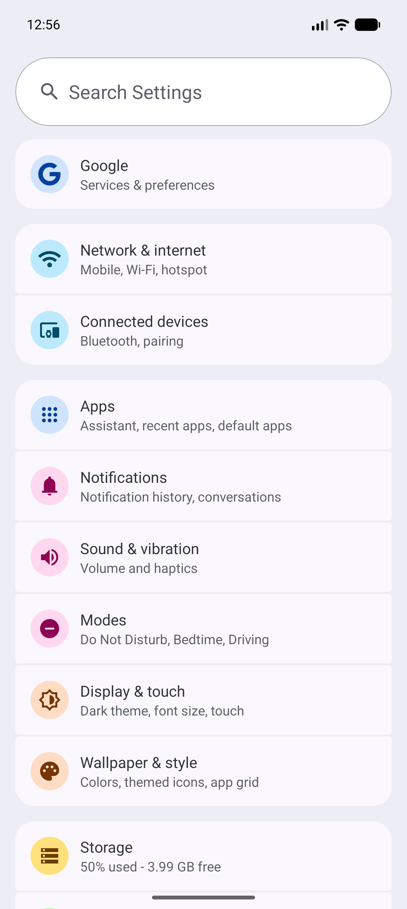
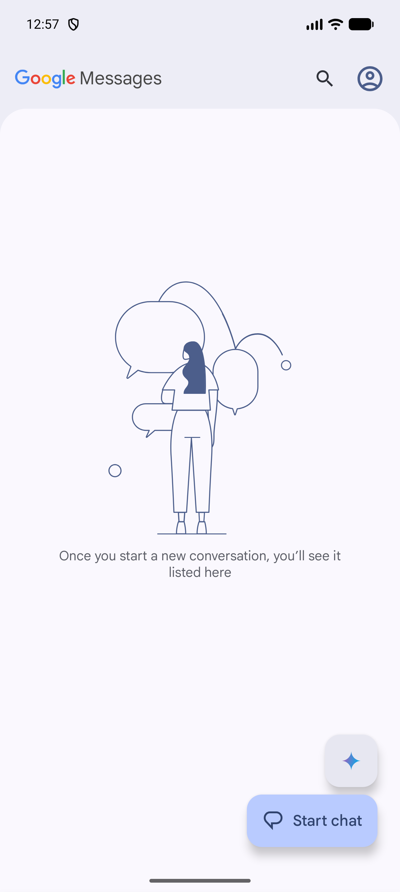
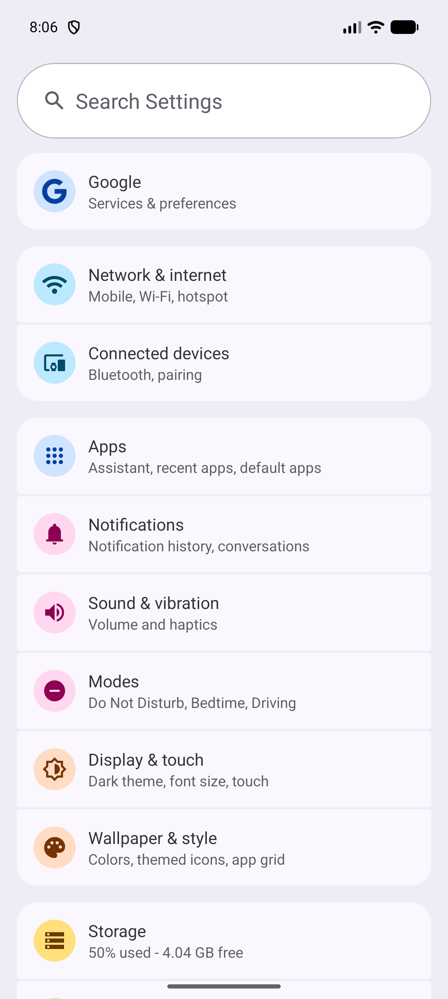
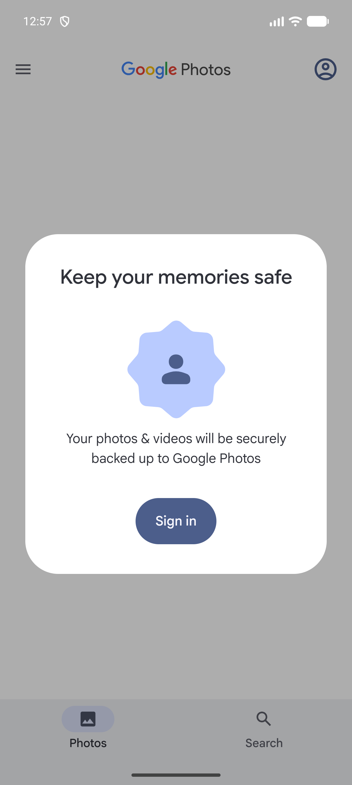
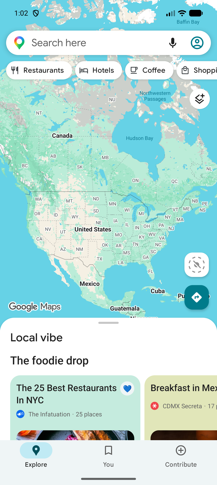

# Android lists, content, and feedback

[Observed] Evidence is limited to the directly inspected Android 17 Emulator surface described in [`../../research/notes/android/direct-observation-log.md`](../../research/notes/android/direct-observation-log.md).

## Grouped card list

- **Pattern name:** [Observed] Grouped card list
- **Platform:** [Observed] Android 17
- **Category:** [Observed] Lists and content
- **Description:** [Observed] Related rows are placed in rounded containers, with either internal dividers or one card per item.
- **Purpose:** [Inferred] Makes dense settings or scheduled-item content easier to scan as semantic groups.
- **Visual structure:** [Observed] Settings grouped category rows inside pale rounded containers; Clock presented each alarm as a dark rounded card containing time, recurrence, expand, and switch controls.
- **Interaction:** [Observed] Settings rows navigated to detail; Clock cards exposed switches and expand controls.
- **States:** [Observed] Settings showed static title/summary rows; Clock showed two alarm cards with unchecked/off switches reported as `checked="false"`.
- **Variations:** [Observed] Containers may group several adjacent rows (Settings) or hold one complex item each (Clock).
- **Applications observed:** [Observed] Settings, Clock.
- **Screenshot evidence:** [Observed] , [Clock alarm cards](../../../../skills/native-ui-patterns/assets/android/clock/alarm-list.png)
- **Design guidance:** [Inferred] Group by user task, preserve consistent padding, and keep each row's title and state legible.
- **Avoid:** [Inferred] Avoid using visual cards without semantic labels for nested controls.
- **Notes:** [Observed] This recurring pattern was confirmed in two Google apps.

## Illustrated empty state

- **Pattern name:** [Observed] Illustrated empty state
- **Platform:** [Observed] Android 17
- **Category:** [Observed] Empty-state feedback
- **Description:** [Observed] An otherwise empty content area contains a concise explanation and, where relevant, a primary next action.
- **Purpose:** [Inferred] Explains why content is absent and directs the user toward a productive next step.
- **Visual structure:** [Observed] Messages used a large line illustration, explanatory copy, and Start chat action; Files used a storage-box illustration and “No items”; Contacts used “No contacts yet” with an add action.
- **Interaction:** [Observed] Start chat opened a recipient form; Contacts' add action opened a create-contact form; no Files item action was available because Downloads was empty.
- **States:** [Observed] Zero conversations, zero contacts, and zero downloaded items were directly observed.
- **Variations:** [Observed] Empty states may include a primary action (Messages, Contacts) or remain informational (Files).
- **Applications observed:** [Observed] Messages, Contacts, Files.
- **Screenshot evidence:** [Observed] , [Contacts empty state](../../../../skills/native-ui-patterns/assets/android/contacts/empty-list.png), [Files empty state](../../../../skills/native-ui-patterns/assets/android/files/downloads-empty.png)
- **Design guidance:** [Inferred] State the empty condition plainly and provide a safe next action only when one is meaningful.
- **Avoid:** [Inferred] Avoid showing unexplained blank space.
- **Notes:** [Observed] This recurring pattern was confirmed in three Google apps.

## Query-specific no-results recovery

- **Pattern name:** [Observed] Query-specific no-results recovery
- **Platform:** [Observed] Android 17
- **Category:** [Observed] Search feedback
- **Description:** [Observed] Settings replaces the result list with a centered no-results state that repeats the submitted query and suggests Tips & Support.
- **Purpose:** [Inferred] Confirms that search completed without a match while suggesting a related place to continue.
- **Visual structure:** [Observed] A question-mark icon sits above “Try searching in Tips & Support” and “No results for zzzzzzzz”; the active query remains visible between Back and Clear text actions.
- **Interaction:** [Observed] Entering temporary text `zzzzzzzz` produced the no-results state without opening a result or changing a setting; Clear text and Back returned to the Settings landing surface.
- **States:** [Observed] Landing, focused query, no-results, cleared, and returned states were directly observed.
- **Variations:** [Unconfirmed] No second Google app was directly observed with the same query-specific recovery treatment.
- **Applications observed:** [Observed] Settings only.
- **Screenshot evidence:** [Observed] , [query-specific no-results feedback](../../../../skills/native-ui-patterns/assets/android/settings/search-no-results.png), [Settings after clearing and leaving search](../../../../skills/native-ui-patterns/assets/android/settings/search-after-clear.png)
- **Design guidance:** [Inferred] Echo the unsuccessful query, retain clear exit and reset actions, and surface a related suggestion only when it is relevant.
- **Avoid:** [Inferred] Avoid presenting a blank result area or implying that the query itself is invalid.
- **Notes:** [Observed] Application-specific because this treatment was directly confirmed only in Settings.

## Floating primary action

- **Pattern name:** [Observed] Floating primary action
- **Platform:** [Observed] Android 17
- **Category:** [Observed] Primary action feedback
- **Description:** [Observed] A high-emphasis rounded control floats above content near the lower trailing or center area.
- **Purpose:** [Inferred] Keeps the screen's main creation action reachable while content scrolls.
- **Visual structure:** [Observed] Messages used an extended Start chat control plus a smaller adjacent action; Clock used a centered circular plus control; Contacts used a trailing circular add control.
- **Interaction:** [Observed] Start chat opened New chat, Clock plus opened the time picker, and Contacts add opened Create contact.
- **States:** [Observed] Resting and activated destination states were directly captured.
- **Variations:** [Observed] The control can be extended with text (Messages) or icon-only (Clock, Contacts), and placement can be trailing or centered.
- **Applications observed:** [Observed] Messages, Clock, Contacts.
- **Screenshot evidence:** [Observed] , [Clock](../../../../skills/native-ui-patterns/assets/android/clock/clock-tab.png), [Contacts](../../../../skills/native-ui-patterns/assets/android/contacts/empty-list.png)
- **Design guidance:** [Inferred] Reserve this emphasis for the single most common creation action and provide an accessible label for icon-only variants.
- **Avoid:** [Inferred] Avoid multiple equally prominent actions that compete for the same role.
- **Notes:** [Observed] This recurring pattern was confirmed in three Google apps.

## Sign-in or permission primer

- **Pattern name:** [Observed] Sign-in or permission primer
- **Platform:** [Observed] Android 17
- **Category:** [Observed] Onboarding and blocked-state feedback
- **Description:** [Observed] A focused card or full-page surface explains a benefit before sign-in or permission-dependent behavior.
- **Purpose:** [Inferred] Provides context before requesting account or protected-resource access.
- **Visual structure:** [Observed] Photos showed a centered sign-in card over a dimmed Photos/Search surface; Maps showed an illustrated sign-in screen followed by an audio-permission primer with Continue and Not now; YouTube Music showed an in-app media-access explanation after Device files only was selected.
- **Interaction:** [Observed] Maps supplied Skip and Not now paths; Chrome supplied Stay signed out and No thanks paths; Photos and Play Store exposed sign-in as the only visible progression on the captured surface.
- **States:** [Observed] Benefit explanation, optional deferral, and progression-blocked variants were directly observed.
- **Variations:** [Observed] Primers can be modal cards (Photos), full-page onboarding (Maps, Chrome, YouTube Music), or an account wall (Play Store, Drive).
- **Applications observed:** [Observed] Photos, Maps, Chrome, YouTube Music, Play Store, Drive.
- **Screenshot evidence:** [Observed] , [Maps sign-in onboarding](../../../../skills/native-ui-patterns/assets/android/maps/sign-in-onboarding.png), [Maps permission primer](../../../../skills/native-ui-patterns/assets/android/maps/audio-primer.png), [Chrome signed-out choice](../../../../skills/native-ui-patterns/assets/android/chrome/stay-signed-out-onboarding.png), [YouTube Music media state](../../../../skills/native-ui-patterns/assets/android/youtube-music/media-access-primer.png), [Play Store account wall](../../../../skills/native-ui-patterns/assets/android/play-store/sign-in-required.png)
- **Design guidance:** [Inferred] Explain the immediate value, use the system permission dialog only after a clear primer, and expose a deferral path when the app can function without the capability.
- **Avoid:** [Inferred] Avoid pretending account-walled surfaces were fully inspected.
- **Notes:** [Observed] This recurring pattern was confirmed in multiple Google apps; downstream permission dialogs were not accepted.

## Visible selected and unchecked states

- **Pattern name:** [Observed] Visible selected and unchecked states
- **Platform:** [Observed] Android 17
- **Category:** [Observed] Status feedback
- **Description:** [Observed] Controls communicate state through filled indicators, track/thumb position, text, and UI hierarchy attributes.
- **Purpose:** [Inferred] Lets users distinguish current destinations and unchecked/off toggles without performing an action.
- **Visual structure:** [Observed] Bottom-navigation selections used filled icon backgrounds; Phone's All filter used a filled chip; unchecked/off Clock alarm switches used off-position thumbs.
- **Interaction:** [Observed] Changing bottom destinations moved the filled indicator; switches were deliberately not toggled.
- **States:** [Observed] Selected navigation and filter states and unchecked switch states were directly observed.
- **Variations:** [Observed] Selection used both shape fill and `selected="true"`; binary controls used `checked="false"` in the UI dump.
- **Applications observed:** [Observed] Maps, Clock, Phone, Settings.
- **Screenshot evidence:** [Observed] , [Clock selected Alarm and unchecked/off switches](../../../../skills/native-ui-patterns/assets/android/clock/alarm-list.png), [Phone selected All](../../../../skills/native-ui-patterns/assets/android/phone/empty-home.png), [Settings unchecked Dark theme](../../../../skills/native-ui-patterns/assets/android/settings/display-and-touch.png)
- **Design guidance:** [Inferred] Combine visible state with semantic state rather than relying on color alone.
- **Avoid:** [Inferred] Avoid ambiguous controls whose selected or checked state cannot be read from the accessibility hierarchy.
- **Notes:** [Observed] This recurring pattern was confirmed in at least two Google apps.
