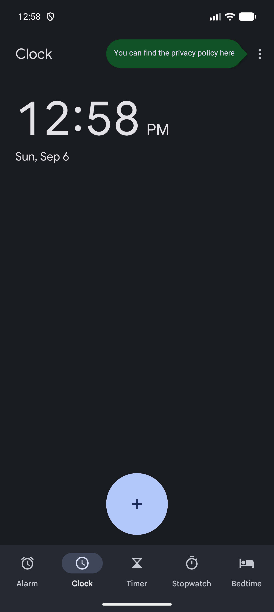
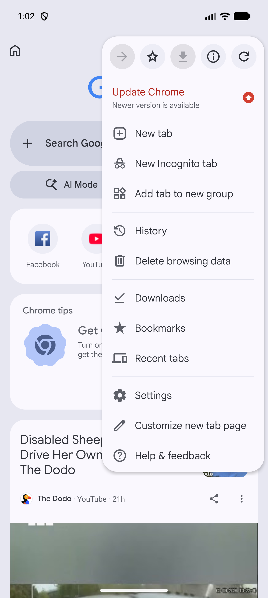
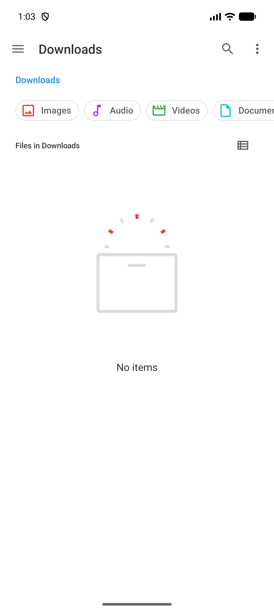

# Android navigation and presentation

[Observed] Evidence is limited to the directly inspected Android 17 Emulator surface described in [`../../research/notes/android/direct-observation-log.md`](../../research/notes/android/direct-observation-log.md). [Observed] Labels in brackets distinguish observation from interpretation.

## Bottom navigation with selected destination

- **Pattern name:** [Observed] Bottom navigation with selected destination
- **Platform:** [Observed] Android 17
- **Category:** [Observed] Primary navigation
- **Description:** [Observed] A persistent bottom row presents labeled destinations; the active destination has a filled indicator and a selected semantic state.
- **Purpose:** [Inferred] Keeps a small set of peer destinations visible while preserving the content area.
- **Visual structure:** [Observed] Icon-over-label items span the bottom edge. Clock showed five destinations; Phone and Maps showed three; Contacts showed two.
- **Interaction:** [Observed] Tapping a destination replaced the main surface while the bottom row remained present.
- **States:** [Observed] Selected items used a filled pill behind the icon and `selected="true"` in UI dumps; unselected items did not.
- **Variations:** [Observed] Labels were always visible in the inspected Clock, Phone, Maps, and Contacts surfaces; item counts varied from two to five.
- **Applications observed:** [Observed] Clock, Phone, Maps, Contacts; Photos also exposed Photos and Search destinations behind its sign-in primer.
- **Screenshot evidence:** [Observed] , [Phone](../../../../skills/native-ui-patterns/assets/android/phone/empty-home.png), [Maps](../../../../skills/native-ui-patterns/assets/android/maps/sheet-collapsed.png), [Contacts](../../../../skills/native-ui-patterns/assets/android/contacts/empty-list.png)
- **Design guidance:** [Inferred] Use this for a small number of peer destinations and expose the selected destination visually and semantically.
- **Avoid:** [Inferred] Avoid using the row for transient actions or omitting labels when destination meaning would become ambiguous.
- **Notes:** [Observed] This recurring pattern was confirmed in at least four Google apps.

## Search-led top surface

- **Pattern name:** [Observed] Search-led top surface
- **Platform:** [Observed] Android 17
- **Category:** [Observed] Navigation and discovery
- **Description:** [Observed] A prominent search field or search action appears at the top of a landing surface.
- **Purpose:** [Inferred] Gives direct access to large or unknown content spaces without requiring hierarchical browsing first.
- **Visual structure:** [Observed] Settings and Phone used wide rounded search fields; Maps used a rounded map search field; Messages used a top-bar search icon that opened a full-width search field.
- **Interaction:** [Observed] Tapping search moved focus into a dedicated search state; Settings exposed results while text was entered, and Messages exposed category shortcuts before a query.
- **States:** [Observed] Resting, focused, populated, and empty-result/category states were directly seen across Settings and Messages.
- **Variations:** [Observed] Search can be an always-visible field (Settings, Phone, Maps, Contacts, Chrome) or an icon that transforms the top surface (Messages).
- **Applications observed:** [Observed] Settings, Phone, Maps, Contacts, Chrome, Messages, Files.
- **Screenshot evidence:** [Observed] , [Settings focused search](../../../../skills/native-ui-patterns/assets/android/settings/search-results.png), [Messages search](../../../../skills/native-ui-patterns/assets/android/messages/search-focused.png), [Phone landing](../../../../skills/native-ui-patterns/assets/android/phone/empty-home.png)
- **Design guidance:** [Inferred] Keep the field near the top, provide a clear exit, and show useful categories or results as soon as search is entered.
- **Avoid:** [Inferred] Avoid a search affordance that loses the user's navigation context without a visible back or clear action.
- **Notes:** [Observed] This recurring pattern was confirmed in at least two Google apps.

## Contextual overlay menu

- **Pattern name:** [Observed] Contextual overlay menu
- **Platform:** [Observed] Android 17
- **Category:** [Observed] Secondary navigation
- **Description:** [Observed] Secondary destinations and actions appear above a dimmed or partially covered base surface.
- **Purpose:** [Inferred] Keeps infrequent actions available without making them primary navigation.
- **Visual structure:** [Observed] Chrome used an upper-right anchored panel with icon-and-label rows; Messages used a near-full-height account sheet with grouped rows.
- **Interaction:** [Observed] Tapping the overflow or account control opened the overlay; system Back dismissed it without activating an item.
- **States:** [Observed] Closed and open states were directly inspected.
- **Variations:** [Observed] The inspected variants were an anchored popup panel in Chrome and an account/utility sheet in Messages.
- **Applications observed:** [Observed] Chrome, Messages.
- **Screenshot evidence:** [Observed] , [Messages account sheet](../../../../skills/native-ui-patterns/assets/android/messages/account-sheet.png)
- **Design guidance:** [Inferred] Group secondary actions, retain the base surface as context, and support dismissal without selection.
- **Avoid:** [Inferred] Avoid placing the most frequent destination only inside an overflow surface.
- **Notes:** [Observed] This recurring pattern was confirmed in two Google apps; the overlay geometry was application-specific.

## Navigation drawer

- **Pattern name:** [Observed] Navigation drawer
- **Platform:** [Observed] Android 17
- **Category:** [Observed] Hierarchical navigation
- **Description:** [Observed] Files opens a left-side drawer over the current Downloads surface.
- **Purpose:** [Inferred] Provides access to storage categories and roots while preserving the current location behind the drawer.
- **Visual structure:** [Observed] A header labeled Files precedes vertically stacked icon-and-label rows such as Recent, Images, Videos, Audio, and Documents.
- **Interaction:** [Observed] Tapping the top-left menu icon opened the drawer; the underlying Downloads surface remained visible and dimmed.
- **States:** [Observed] Closed and open states were directly captured.
- **Variations:** [Unconfirmed] No cross-app variation was established.
- **Applications observed:** [Observed] Files only.
- **Screenshot evidence:** [Observed] , [Files drawer](../../../../skills/native-ui-patterns/assets/android/files/navigation-drawer.png)
- **Design guidance:** [Inferred] Use a drawer for a larger hierarchy of infrequent locations rather than a small set of peer destinations.
- **Avoid:** [Inferred] Avoid treating this as a recurring Android pattern from this audit; it was application-specific.
- **Notes:** [Observed] Application-specific because only Files was directly confirmed.

## Draggable map content sheet

- **Pattern name:** [Observed] Draggable map content sheet
- **Platform:** [Observed] Android 17
- **Category:** [Observed] Spatial presentation
- **Description:** [Observed] Maps layers a vertically movable content surface above the map while retaining search and bottom navigation.
- **Purpose:** [Inferred] Balances map context with browsable place content.
- **Visual structure:** [Observed] The content layer includes rounded top corners and a drag handle; map content remains visible above or behind it depending on position.
- **Interaction:** [Observed] An upward ADB swipe moved the sheet from a lower position to near the top edge.
- **States:** [Observed] Lower and expanded positions were captured.
- **Variations:** [Unconfirmed] Intermediate settling positions and transition timing were not measured.
- **Applications observed:** [Observed] Maps only.
- **Screenshot evidence:** [Observed] , [Expanded sheet](../../../../skills/native-ui-patterns/assets/android/maps/sheet-expanded.png)
- **Design guidance:** [Inferred] Preserve a visible drag cue and maintain stable primary navigation while the sheet moves.
- **Avoid:** [Inferred] Avoid claiming motion curves or timing from still captures.
- **Notes:** [Observed] Application-specific because only Maps was directly confirmed.
