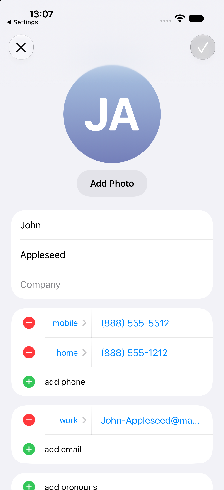
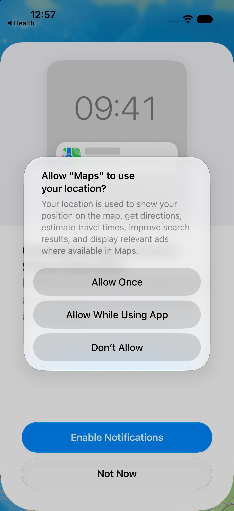
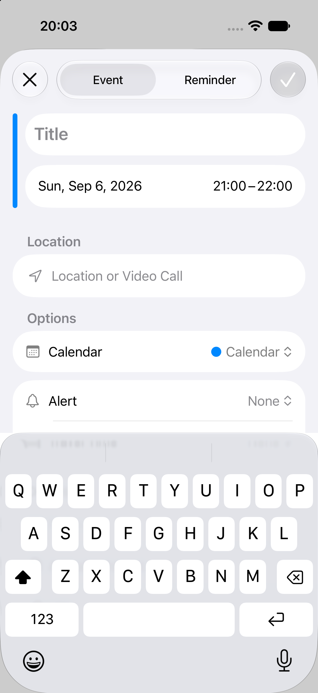
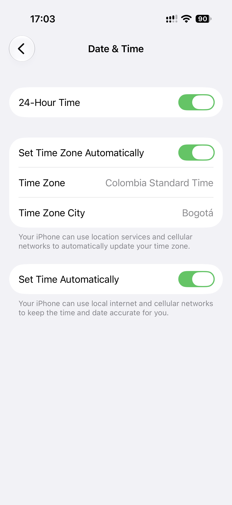
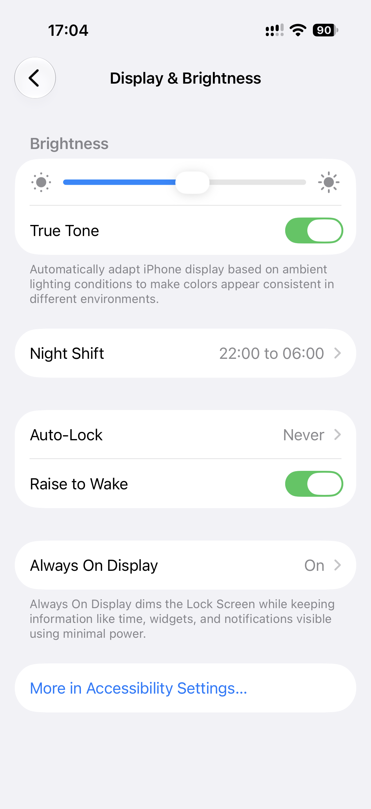
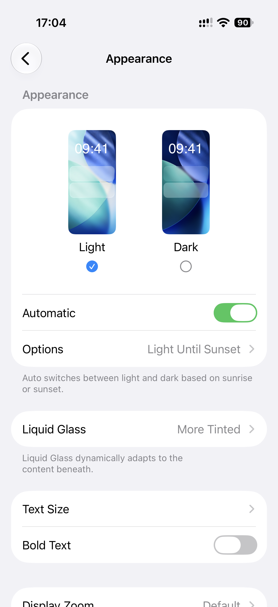
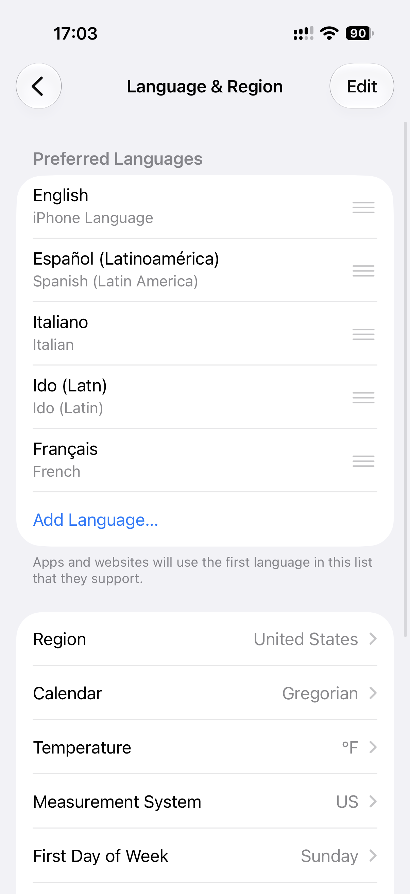
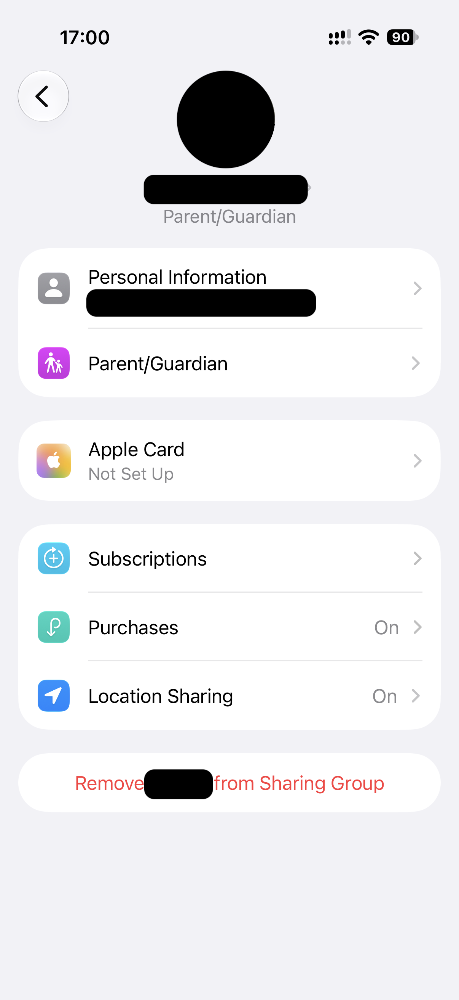

# iOS forms and controls patterns

## Grouped form rows

- **Pattern name:** [Observed] Grouped form rows.
- **Platform:** [Observed] iOS 27.0 Simulator. [Observed] iOS 27.0, physical iPhone 17 Pro (2026-09-08 set).
- **Category:** [Observed] Forms.
- **Description:** [Observed] Related values are arranged in rounded white groups with thin internal separators. [Observed] The same container also holds read-only and navigable settings rows outside any editing task.
- **Purpose:** [Inferred] Make dense forms scannable by grouping related inputs and options.
- **Visual structure:** [Observed] Contacts groups name fields, phone rows, and email rows; Calendar groups title, date/time, location, calendar, and alert controls. [Observed] A small gray left-aligned caption can name the group above the card, outside it. [Observed] A small gray left-aligned paragraph can follow the card below it, outside it, and wrap to two or more lines.
- **Interaction:** [Observed] Entering each task surface made the first editable field available; Calendar placed insertion focus in Title.
- **States:** [Observed] Populated values, placeholders, add rows, remove controls, and a muted checkmark were visible.
- **Variations:** [Observed] Contacts uses red minus and green plus controls; Calendar uses labeled option rows with trailing current values. [Observed] One card can mix switch rows, value-plus-chevron rows, chevron-only rows, and blue link rows when the group is formed by topic.
- **Trailing accessory:** [Observed] Chevron; gray value then chevron; switch; diagonal up-right arrow; count then arrow; none on read-only rows. [Inferred] The diagonal arrow marks a row that leaves the current hierarchy; no such row was tapped. [Observed] The audit set also showed a circled info button as a separate trailing target, a stacked up-and-down caret after a value, and a blue check at the leading edge of a selected row; those captures are not yet imported.
- **Applications observed:** [Observed] Contacts, Calendar. [Observed] Settings, 2026-09-08 set.
- **Applicability:** [Inferred] general idiom.
- **Screenshot evidence:** [Observed] , [Calendar event form](../../../../skills/native-ui-patterns/assets/ios/calendar/event-form.png), [Settings section header and footer captions](../../../../skills/native-ui-patterns/assets/ios/settings/sign-in-security-captions.png), [Settings external-link rows](../../../../skills/native-ui-patterns/assets/ios/settings/external-link-rows.png).
- **Design guidance:** [Inferred] Group related fields, preserve readable labels, and show current option values at the trailing edge. [Inferred] Name a group with a caption above the card, and state its consequence in a caption below the card.
- **Avoid:** [Inferred] Avoid relying on dividers alone when the relationship between rows is unclear.
- **Notes:** [Observed] Inspection stopped before any persistent value was changed. [Observed] In the Settings capture, black boxes cover the account values; the row labels, dividers, and chevrons are unaltered. [Observed] On the external-link capture, two black boxes cover the account name and the account email address in the profile row; the trailing arrow, the dividers, and every other row are unaltered.

## Search field with dictation affordance

- **Pattern name:** [Observed] Search field with dictation affordance.
- **Platform:** [Observed] iOS 27.0 Simulator.
- **Category:** [Observed] Input control.
- **Description:** [Observed] A rounded search field pairs a leading magnifying-glass icon with a trailing microphone button.
- **Purpose:** [Inferred] Offer text and voice entry from the same high-visibility control.
- **Visual structure:** [Observed] Placeholder text occupies the center-left; the microphone is visually separated at the trailing edge.
- **Interaction:** [Observed] The visible Search controls were exposed to UI automation by label; no dictation was started.
- **States:** [Observed] Idle fields were captured; Messages showed the same field below populated conversation rows.
- **Variations:** [Observed] Settings anchors Search near the bottom over scrolling content, while Files and Shortcuts place it below the page title.
- **Applications observed:** [Observed] Settings, Files, Messages, Shortcuts.
- **Screenshot evidence:** [Observed] , [Files](../../../../skills/native-ui-patterns/assets/ios/files/browse.png), [Messages](../../../../skills/native-ui-patterns/assets/ios/messages/conversation-list.png), [Shortcuts](../../../../skills/native-ui-patterns/assets/ios/shortcuts/empty-library.png).
- **Design guidance:** [Inferred] Keep search placement stable within a screen and provide a clear text placeholder.
- **Avoid:** [Inferred] Avoid treating the microphone as decoration; it should remain a distinct control when dictation is offered.
- **Notes:** [Unconfirmed] Safari focus behavior was not cataloged because the bounded coordinate-based UI test hung and was terminated before a screenshot was captured.

## System permission alert

- **Pattern name:** [Observed] System permission alert.
- **Platform:** [Observed] iOS 27.0 Simulator.
- **Category:** [Observed] Permission control.
- **Description:** [Observed] A centered rounded alert names the requesting app, explains the requested capability, dims the app, and presents explicit choices.
- **Purpose:** [Inferred] Request informed consent at the point a protected capability is needed.
- **Visual structure:** [Observed] Location prompts stack three full-width choices; the Photos notification prompt uses two side-by-side choices.
- **Interaction:** [Observed] Wallet’s “Don’t Allow” choice was tapped through XCTest UI automation; no permission was granted.
- **States:** [Observed] Location and notification request variants were captured.
- **Variations:** [Observed] Maps, Wallet, and Calendar requested location; Photos requested notifications.
- **Applications observed:** [Observed] Maps, Wallet, Calendar, Photos.
- **Screenshot evidence:** [Observed] , [Wallet location](../../../../skills/native-ui-patterns/assets/ios/wallet/location-permission.png), [Calendar location](../../../../skills/native-ui-patterns/assets/ios/calendar/day-location-permission.png), [Photos notifications](../../../../skills/native-ui-patterns/assets/ios/photos/library-notification-permission.png).
- **Design guidance:** [Inferred] Explain the concrete use before presenting choices and keep refusal available.
- **Avoid:** [Inferred] Avoid obscuring which app or capability is being requested.
- **Notes:** [Observed] No permission or security control was bypassed.

## Add and remove rows (application-specific)

- **Pattern name:** [Observed] Add and remove rows (application-specific).
- **Platform:** [Observed] iOS 27.0 Simulator.
- **Category:** [Observed] Editing control.
- **Description:** [Observed] Contacts prefixes existing repeatable values with red minus controls and new-value rows with green plus controls.
- **Purpose:** [Inferred] Support editing a variable number of phone and email values inline.
- **Visual structure:** [Observed] Type labels and values share a row; add rows use action text such as “add phone” and “add email.”
- **Interaction:** [Unconfirmed] Removal confirmation was not reached before automation was bounded and stopped.
- **States:** [Observed] Existing and add-new row states were visible.
- **Variations:** [Observed] Phone and email groups share the same structure.
- **Applications observed:** [Observed] Contacts only; application-specific.
- **Screenshot evidence:** [Observed] .
- **Design guidance:** [Inferred] Keep destructive and additive row actions visually distinct and adjacent to the affected value.
- **Avoid:** [Inferred] Avoid placing a destructive row control where it can be confused with navigation.
- **Notes:** [Observed] No contact was modified or deleted.

## Content-gated commit control

- **Pattern name:** [Observed] Content-gated commit control.
- **Platform:** [Observed] iOS 27.0 Simulator.
- **Category:** [Observed] Form and composer feedback.
- **Description:** [Observed] A commit control is unavailable while required content is empty and becomes available after text is entered.
- **Purpose:** [Inferred] Prevent an empty event or message from being committed instead of reporting an avoidable error afterward.
- **Visual structure:** [Observed] Calendar keeps a circular Done checkmark visible in a muted disabled style, then fills it with tint when Title contains text; Messages omits the Send arrow while its composer is empty, then shows a blue Send arrow when text is present.
- **Interaction:** [Observed] Temporary text was entered in Calendar Title and the Messages composer, then cleared without activating Done or Send.
- **States:** [Observed] Empty, temporarily populated, and cleared states were directly inspected; Calendar exposed Done as disabled when empty and enabled when populated, while Messages exposed Send only when populated.
- **Variations:** [Observed] Calendar changes the enabled appearance of a persistent control; Messages adds or removes the send control.
- **Applications observed:** [Observed] Calendar, Messages.
- **Screenshot evidence:** [Observed] , [Calendar event form with enabled Done control](../../../../skills/native-ui-patterns/assets/ios/calendar/event-title-entered.png), [Calendar after discarding the temporary event](../../../../skills/native-ui-patterns/assets/ios/calendar/day-after-event-discard.png), [Messages empty composer](../../../../skills/native-ui-patterns/assets/ios/messages/composer-empty.png), [Messages populated composer](../../../../skills/native-ui-patterns/assets/ios/messages/composer-text-entered.png), [Messages composer after clearing](../../../../skills/native-ui-patterns/assets/ios/messages/composer-after-clear.png).
- **Design guidance:** [Inferred] Gate an action when its minimum required content is absent, and make the transition to availability visually legible.
- **Avoid:** [Inferred] Avoid treating disabled action gating as proof that all entered content has been validated.
- **Notes:** [Observed] No event was saved and no message was sent. [Unconfirmed] Validation after activating Done or Send was not inspected because those actions crossed the persistence or sending boundary.

## Switch row

- **Pattern name:** [Observed] Switch row.
- **Platform:** [Observed] iOS 27.0, physical iPhone 17 Pro (2026-09-08 set).
- **Category:** [Observed] Controls.
- **Description:** [Observed] A row pairs a leading text label with a trailing switch that shows the current binary value.
- **Purpose:** [Inferred] Change a binary setting in place and show its value without a detail screen.
- **Visual structure:** [Observed] A horizontally elongated rounded track sits at the trailing edge of the row. [Observed] The track is vertically centered against the leading label. [Observed] The on state fills the track green and puts a white knob at the trailing end. [Observed] The off state uses a light gray track and puts the knob at the leading end. [Observed] A switch row can be the only row in its card, with or without a gray footer sentence below the card. [Observed] A switch row can be the first row of a card whose next rows are gray label-and-value rows behind thin dividers. [Observed] A switch row can also follow a divider under a slider row, a picker, or a value-and-chevron row in the same card.
- **Interaction:** [Unconfirmed] No switch was toggled.
- **States:** [Observed] On and off. [Unconfirmed] Disabled.
- **Variations:** [Observed] With and without a footer caption. [Observed] Alone in a card, or grouped with rows of other kinds.
- **Applications observed:** [Observed] Settings, 17 screens in the 2026-09-08 set, 2 of them imported.
- **Applicability:** [Inferred] system control.
- **Screenshot evidence:** [Observed] , [stacked switch and footer units with an off switch](../../../../skills/native-ui-patterns/assets/ios/settings/stacked-switches-footers.png).
- **Design guidance:** [Inferred] Keep the switch at the trailing edge and the label at the leading edge. [Inferred] Put the explanation in a footer caption outside the card, and place dependent rows directly below the switch.
- **Avoid:** [Inferred] Avoid a switch row with no visible text label. [Inferred] Avoid an explanation that only the knob position states.
- **Notes:** [Unconfirmed] What the dependent rows do when the switch is off. [Unconfirmed] Icon-led switch rows, identity switch rows, and a switch after a divider in a feature hero card are recorded in the 2026-09-08 set, but this batch imports no capture of them.

## Inline slider row

- **Pattern name:** [Observed] Inline slider row.
- **Platform:** [Observed] iOS 27.0, physical iPhone 17 Pro (2026-09-08 set).
- **Category:** [Observed] Value selection.
- **Description:** [Observed] The first row of a grouped card holds a slider that spans the row and carries no text label.
- **Purpose:** [Inferred] Set a continuous value in place and read its position without a dialog.
- **Visual structure:** [Observed] A thin rounded track spans the row between two glyphs of one family. [Observed] A small dim sun glyph sits at the leading end. [Observed] A larger bright sun glyph sits at the trailing end. [Observed] The track is blue to the leading side of a white rounded thumb, and light gray to the trailing side. [Observed] A thin divider separates the slider row from the switch row below it in the same card. [Observed] A gray section header caption sits above the card.
- **Interaction:** [Unconfirmed] No drag was made.
- **States:** [Observed] One settled thumb position. [Unconfirmed] Minimum, maximum, drag, and disabled.
- **Variations:** [Observed] One glyph pair in the imported capture. [Unconfirmed] A second glyph pair is recorded on a capture that this batch does not import.
- **Applications observed:** [Observed] Settings, 2 screens in the 2026-09-08 set: Display & Brightness, and Sounds & Haptics, which is not imported.
- **Applicability:** [Inferred] system control.
- **Screenshot evidence:** [Observed] .
- **Design guidance:** [Inferred] Bound the track with a small glyph and a large glyph of one family to name the scale without text.
- **Avoid:** [Inferred] Avoid a slider whose scale direction is stated only by the fill color.
- **Notes:** [Unconfirmed] A still image does not establish the drag threshold, the step size, or the value range.

## Visual option picker

- **Pattern name:** [Observed] Visual option picker.
- **Platform:** [Observed] iOS 27.0, physical iPhone 17 Pro (2026-09-08 set).
- **Category:** [Observed] Value selection.
- **Description:** [Observed] Device-shaped preview tiles in one card show each outcome, and one tile is marked as selected.
- **Purpose:** [Inferred] Choose between a few exclusive outcomes whose difference is visual, by comparing rendered previews.
- **Visual structure:** [Observed] Two or three device-shaped tiles sit side by side in one card with equal spacing. [Observed] Each tile renders a miniature of its own outcome. [Observed] A caption sits below each tile. [Observed] Two selection cues were seen. [Observed] In Appearance, a filled blue circle with a white check sits below the selected caption, and an empty outlined circle sits below the other. [Observed] In the Notifications "Display As" group, the selected caption sits inside a filled blue capsule, and the selected tile has a blue outline and a blue tint. [Observed] The other captions in that group are plain black text with no control. [Observed] A divider and more rows follow the tiles in Appearance. [Observed] A gray footer sentence follows the card in Notifications. [Observed] A gray section header caption sits above both cards.
- **Interaction:** [Unconfirmed] No option was selected.
- **States:** [Observed] One selected option per screen.
- **Variations:** [Observed] A radio-style circle below the caption, with 2 options. [Observed] A capsule-highlighted caption with a tinted tile, with 3 options.
- **Applications observed:** [Observed] Settings, 2 screens in the 2026-09-08 set.
- **Applicability:** [Inferred] settings idiom.
- **Screenshot evidence:** [Observed] , [Notifications picker with a capsule cue](../../../../skills/native-ui-patterns/assets/ios/settings/notifications-display-picker.png).
- **Design guidance:** [Inferred] Show the outcome inside the tile, and put one selection cue in the same position under every option.
- **Avoid:** [Inferred] Avoid two different selection cues on one screen. [Inferred] Avoid a tile that does not render its own outcome.
- **Notes:** [Unconfirmed] Whether the two selection cues are interchangeable, and what rule selects one of them.

## Link-style action row

- **Pattern name:** [Observed] Link-style action row.
- **Platform:** [Observed] iOS 27.0, physical iPhone 17 Pro (2026-09-08 set).
- **Category:** [Observed] Forms and controls.
- **Description:** [Observed] A row whose only content is blue text, with no leading icon, no chevron, and no trailing value.
- **Purpose:** [Inferred] Present a command, an additive action, or a secondary link that reads as tappable without full row chrome.
- **Visual structure:** [Observed] Three row placements appear in the imported captures. [Observed] The row is the last row of a data group and reads as an add action, left-aligned, with a trailing ellipsis. [Observed] The row is the only row in its own card, centered, with a gray footer below the card. [Observed] The row sits above a red row inside one card of commands, left-aligned, with a thin divider between the two rows. [Observed] Blue link text also ends a gray caption paragraph above the first card, and ends a checklist inside a card. [Observed] The audit also saw a cardless centered blue link on the page background below the last card; that capture is not imported.
- **Interaction:** [Unconfirmed] No row was activated.
- **States:** [Observed] Resting only.
- **Variations:** [Observed] Last row of a data group, sole row of its own card, or first row of a command card above a destructive row. [Observed] Centered or left-aligned. [Observed] Footer present or absent.
- **Applications observed:** [Observed] Settings, 2026-09-08 set, 11 screens; 3 imported.
- **Applicability:** [Inferred] system control.
- **Screenshot evidence:** [Observed] , [blue command card above a red command card](../../../../skills/native-ui-patterns/assets/ios/settings/offload-delete-command-cards.png), [blue row above a red row in one card](../../../../skills/native-ui-patterns/assets/ios/settings/link-over-destructive-card.png).
- **Design guidance:** [Inferred] Reserve the blue text-only row for an action or a link. [Inferred] Keep the whole width of the row tappable, and state the consequence in a footer below the card.
- **Avoid:** [Inferred] Avoid a blue row for navigation that a chevron row already expresses.
- **Notes:** [Observed] On the blue-over-red capture, two black boxes cover a serial number and an agreement number in the card above the command card; the rows, the divider, and the card edges are unaltered. [Unconfirmed] Whether the trailing ellipsis marks a row that opens a further surface.

## Destructive action row

- **Pattern name:** [Observed] Destructive action row.
- **Platform:** [Observed] iOS 27.0, physical iPhone 17 Pro (2026-09-08 set).
- **Category:** [Observed] Forms and controls.
- **Description:** [Observed] Red text on a row with no icon, chevron, or value.
- **Purpose:** [Inferred] Isolate an irreversible or account-level action so it is not mistaken for navigation, and state its consequence before activation.
- **Visual structure:** [Observed] The row is alone in its own card, placed last on the screen, separated from the card above by whitespace, with its text centered. [Observed] The row can instead share one card with a blue row above it, separated by a thin divider, with both labels left-aligned. [Observed] A gray footer below the card states the consequence in one sentence on the offload-and-delete capture. [Observed] Two gray footer paragraphs follow the card on the sign-out capture; the first names the signed-in account by an account identifier (a black box covers the identifier), and the second states that the account is used on other devices. [Observed] The centered card on the family-member capture carries no footer. [Observed] On the offload-and-delete capture a blue card stacks above the red card, and each card has its own footer, so the two actions differ by color and footer only.
- **Interaction:** [Unconfirmed] No row was activated, and no confirmation dialog was captured.
- **States:** [Observed] Resting only.
- **Variations:** [Observed] Standalone card, or grouped under a link row in one card. [Observed] Centered or left-aligned. [Observed] Footer present or absent.
- **Applications observed:** [Observed] Settings, 2026-09-08 set, 5 screens; 4 imported.
- **Applicability:** [Inferred] system control.
- **Screenshot evidence:** [Observed] , [centered red row with a consequence footer](../../../../skills/native-ui-patterns/assets/ios/settings/sign-out-row-footer.png), [blue card above a red card, each with a footer](../../../../skills/native-ui-patterns/assets/ios/settings/offload-delete-command-cards.png), [red row under a blue row in one card](../../../../skills/native-ui-patterns/assets/ios/settings/link-over-destructive-card.png).
- **Design guidance:** [Inferred] Keep the destructive row last, alone or below its non-destructive sibling. [Inferred] State the consequence in a footer below the card.
- **Avoid:** [Inferred] Avoid red for a reversible command. [Inferred] Avoid red text inside a row that also navigates.
- **Notes:** [Observed] On the centered capture, a black box covers a name inside the red row label, and a black circle and two black boxes cover the identity header and one row value above it; the card edges, the dividers, and the chevrons are unaltered. [Observed] On the sign-out capture a black box covers the account identifier in the first footer paragraph; the sentence around it, the row, and the card are unaltered. [Unconfirmed] What follows activation.
