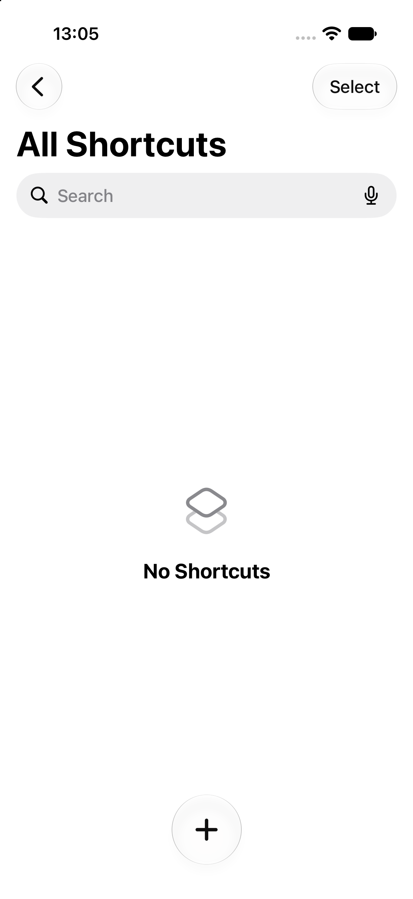
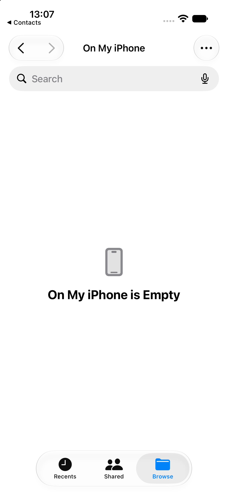
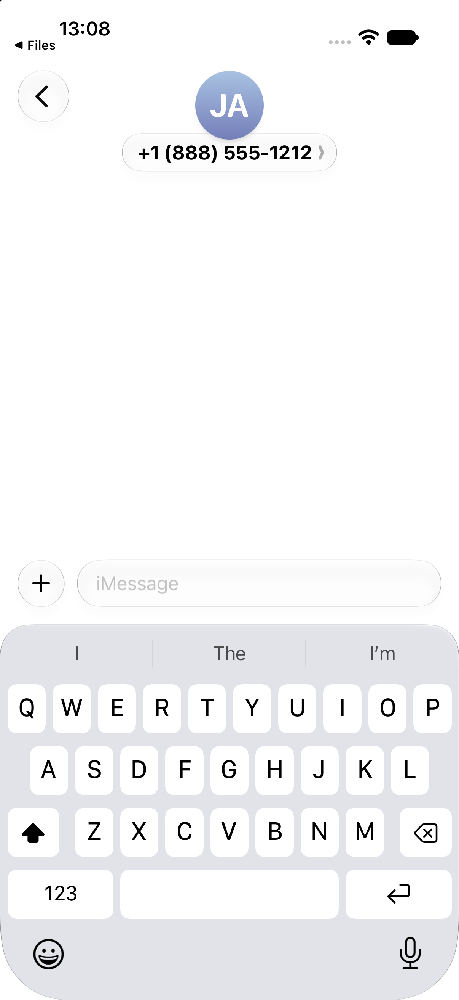
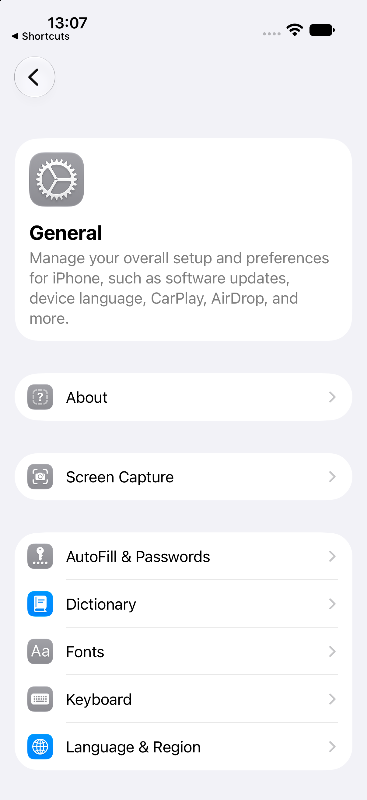

# iOS interaction and accessibility patterns

## Explicit selection mode (application-specific)

- **Pattern name:** [Observed] Explicit selection mode (application-specific).
- **Platform:** [Observed] iOS 27.0 Simulator.
- **Category:** [Observed] Selection.
- **Description:** [Observed] Shortcuts replaces Select with Select All and a blue checkmark Done control, then exposes a disabled bottom action bar.
- **Purpose:** [Inferred] Separate bulk actions from normal browsing and creation.
- **Visual structure:** [Observed] The page title and Search remain in place; duplicate, folder, and trash actions appear together at the bottom.
- **Interaction:** [Observed] Tapping Select entered the mode.
- **States:** [Observed] Normal empty state and empty-selection mode were captured; bottom actions were muted with no selected items.
- **Variations:** [Unconfirmed] Selection with one or more shortcuts was unavailable in the fresh data set.
- **Applications observed:** [Observed] Shortcuts only; application-specific.
- **Screenshot evidence:** [Observed] , [Selection mode](../../../../skills/native-ui-patterns/assets/ios/shortcuts/empty-selection-mode.png).
- **Design guidance:** [Inferred] Make mode entry and exit explicit and disable actions that have no valid target.
- **Avoid:** [Inferred] Avoid visually enabling destructive actions when nothing is selected.
- **Notes:** [Observed] No shortcut existed, so no item was changed.

## Anchored overflow menu (application-specific)

- **Pattern name:** [Observed] Anchored overflow menu (application-specific).
- **Platform:** [Observed] iOS 27.0 Simulator.
- **Category:** [Observed] Menu.
- **Description:** [Observed] Files opens a rounded menu anchored below its ellipsis control with Connect to Server and Edit commands.
- **Purpose:** [Inferred] Keep infrequent destination-level actions near the navigation controls without occupying permanent space.
- **Visual structure:** [Observed] The compact menu floats over Browse and aligns to the trailing top controls.
- **Interaction:** [Observed] Tapping the accessibility-labeled More button opened the menu.
- **States:** [Observed] Closed and open menu states were captured.
- **Variations:** [Unconfirmed] Submenus and destructive menu items were not observed.
- **Applications observed:** [Observed] Files only; application-specific.
- **Screenshot evidence:** [Observed] , [Open](../../../../skills/native-ui-patterns/assets/ios/files/more-menu.png).
- **Design guidance:** [Inferred] Anchor overflow commands to the invoking control and use plain action labels.
- **Avoid:** [Inferred] Avoid placing the app’s primary action only inside an overflow menu.
- **Notes:** [Observed] A separate keyboard tutorial sheet also appeared at the bottom of the captured open-menu state; it was not treated as part of the Files menu.

## Immediate keyboard focus

- **Pattern name:** [Observed] Immediate keyboard focus.
- **Platform:** [Observed] iOS 27.0 Simulator.
- **Category:** [Observed] Keyboard and focus.
- **Description:** [Observed] Entering a composition or creation surface can immediately reveal the software keyboard and insertion focus.
- **Purpose:** [Inferred] Reduce the extra tap before the user’s main text-entry task.
- **Visual structure:** [Observed] Messages keeps the composer directly above the keyboard; Calendar keeps Title and key event options visible above it.
- **Interaction:** [Observed] Opening a Messages conversation revealed its composer keyboard; opening Calendar’s event form placed a caret in Title.
- **States:** [Observed] Empty message composition and empty event title states were captured.
- **Variations:** [Observed] Messages uses a single-line composer; Calendar uses a form with predictive suggestions above the keys.
- **Applications observed:** [Observed] Messages, Calendar.
- **Screenshot evidence:** [Observed] , [Calendar event form](../../../../skills/native-ui-patterns/assets/ios/calendar/event-form.png).
- **Design guidance:** [Inferred] Auto-focus only when text entry is the clear primary task and keep the focused field visible.
- **Avoid:** [Inferred] Avoid forcing the keyboard over content on a browsing-first destination.
- **Notes:** [Observed] No text was entered or sent.

## Accessibility-labeled visible controls

- **Pattern name:** [Observed] Accessibility-labeled visible controls.
- **Platform:** [Observed] iOS 27.0 Simulator.
- **Category:** [Observed] Accessibility and automation.
- **Description:** [Observed] Visible controls could be located by semantic labels matching their text or action, including General, John Appleseed, Edit, Browse, More, Select, Continue, Add, and Don’t Allow.
- **Purpose:** [Inferred] Provide a meaningful programmatic identity to interactive elements.
- **Visual structure:** [Observed] Labels corresponded to text controls, icon-plus-text controls, and icon-only controls such as More and Add.
- **Interaction:** [Observed] XCTest used those labels to tap controls in Settings, Contacts, Files, Shortcuts, Calendar, Photos, Reminders, and Wallet.
- **States:** [Observed] Successful label-based activation was confirmed by the resulting captured destination or mode.
- **Variations:** [Observed] Text-visible and icon-only control variants were both discoverable; Safari’s address control was not found by the attempted label query.
- **Applications observed:** [Observed] Settings, Contacts, Files, Shortcuts, Calendar, Photos, Reminders, Wallet.
- **Screenshot evidence:** [Observed] , [Contact detail](../../../../skills/native-ui-patterns/assets/ios/contacts/contact-detail.png), [Files menu](../../../../skills/native-ui-patterns/assets/ios/files/more-menu.png), [Shortcuts selection](../../../../skills/native-ui-patterns/assets/ios/shortcuts/empty-selection-mode.png).
- **Design guidance:** [Inferred] Give every actionable icon a concise semantic label and keep visible text aligned with the programmatic name.
- **Avoid:** [Inferred] Avoid inferring VoiceOver reading order or spoken output from XCTest discoverability alone.
- **Notes:** [Unconfirmed] VoiceOver, Switch Control, Dynamic Type changes, contrast modes, and hardware-keyboard navigation were not directly tested in the bounded slice.
