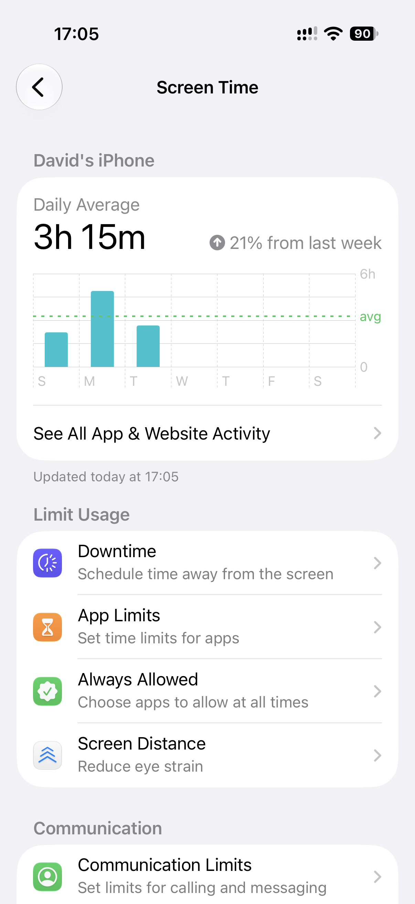
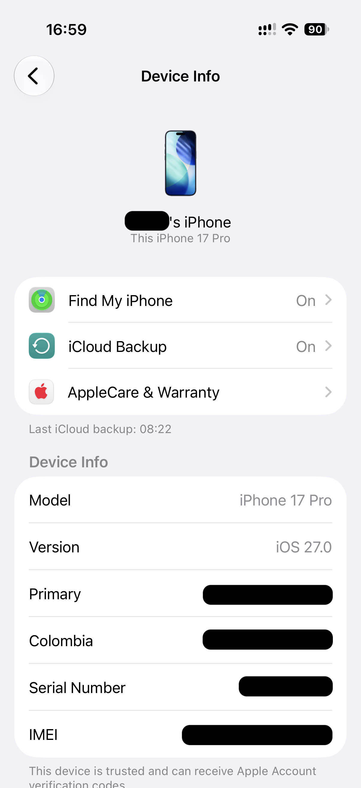
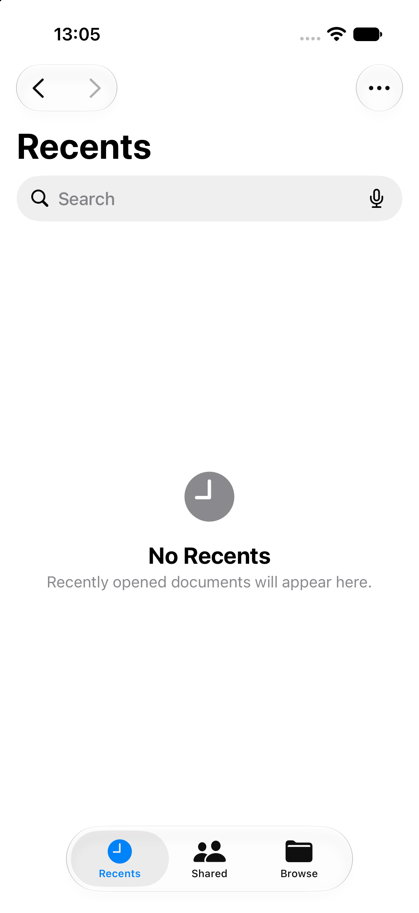
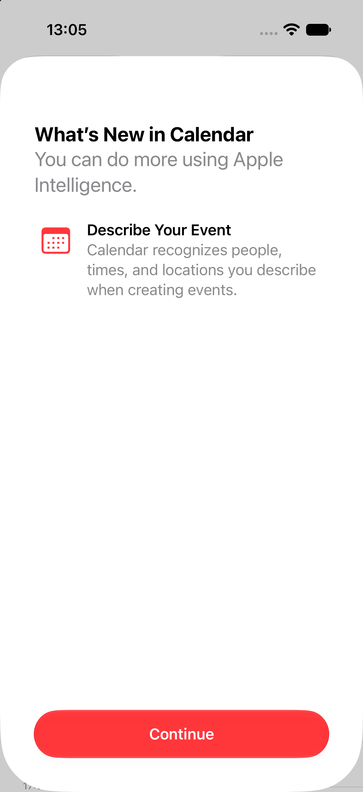
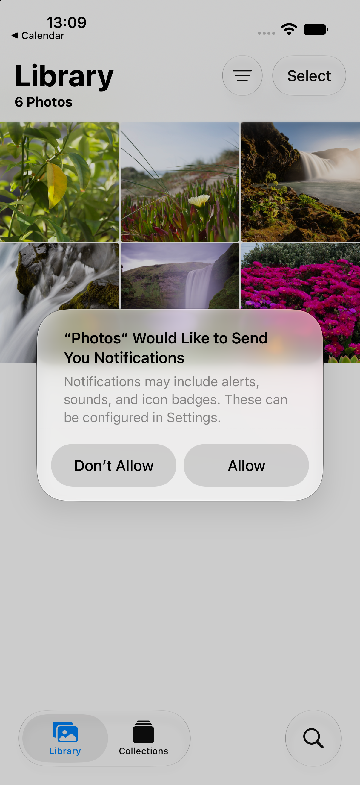
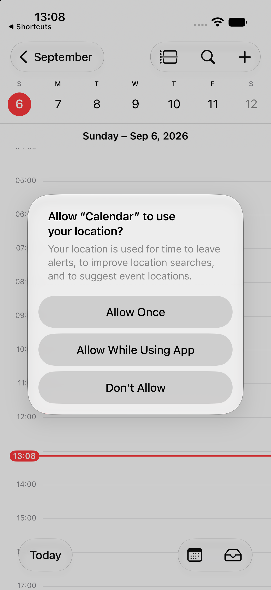

# iOS lists, content, and feedback patterns

## Identity-led list row

- **Pattern name:** [Observed] Identity-led list row.
- **Platform:** [Observed] iOS 27.0 Simulator. [Observed] iOS 27.0, physical iPhone 17 Pro (2026-09-08 set).
- **Category:** [Observed] Lists.
- **Description:** [Observed] A circular initials badge leads a primary identity label, optional secondary metadata, and trailing disclosure or date metadata. [Observed] The leading image can also be a photograph, a rounded-square app icon, or a grouped-thumbnail cue.
- **Purpose:** [Inferred] Make people and conversations scannable before reading supporting metadata.
- **Visual structure:** [Observed] Contacts groups rows alphabetically and adds an index rail; Messages pairs the badge with phone number and date. [Observed] In Settings the rows sit inside grouped cards with no index rail. [Observed] The leading image is a circular photograph, three overlapped circular thumbnails as a group cue, or a rounded-square app icon. [Observed] Secondary text is one to three gray lines: a product, a renewal date, or a date on its own line. [Observed] A long primary label truncates mid-string with an ellipsis. [Observed] The trailing zone holds a gray price and then a chevron.
- **Interaction:** [Observed] Tapping John Appleseed opened contact detail; tapping the first Messages row opened its conversation.
- **States:** [Observed] Rows with and without secondary text were captured. [Observed] A signed-in account row uses a large circular image slot, a bold primary line, and a gray status line, where the earlier Simulator capture of the same screen shows a dotted circle and a sign-in prompt.
- **Variations:** [Observed] Contacts uses alphabetical section headers; Messages uses unsectioned conversation rows. [Observed] Photograph, grouped-thumbnail, and app-icon leading images; one, two, or three secondary lines; a trailing price before the chevron; a truncated primary label.
- **Applications observed:** [Observed] Contacts, Messages. [Observed] Settings, 2026-09-08 set.
- **Applicability:** [Inferred] general idiom.
- **Screenshot evidence:** [Observed] , [Messages list](../../../../skills/native-ui-patterns/assets/ios/messages/conversation-list.png), [Contact detail](../../../../skills/native-ui-patterns/assets/ios/contacts/contact-detail.png), [Conversation](../../../../skills/native-ui-patterns/assets/ios/messages/conversation-empty-composer.png), [Settings signed-in account and Family rows](../../../../skills/native-ui-patterns/assets/ios/settings/root-signed-in.png), [Settings app rows with metadata and a trailing price](../../../../skills/native-ui-patterns/assets/ios/settings/app-icon-rows-metadata.png).
- **Design guidance:** [Inferred] Put the recognition cue first, primary label next, and time or disclosure metadata at the trailing edge.
- **Avoid:** [Inferred] Avoid giving secondary metadata equal emphasis to the identity label.
- **Notes:** [Observed] Simulator-provided sample contacts and conversations were viewed without sending or editing anything. [Observed] On the Settings root capture a black box covers the account name, and solid black shapes cover the account photograph and the three Family thumbnails; the row structure, the gray status line, and the chevrons are unaltered.

## Icon-led settings row

- **Pattern name:** [Observed] Icon-led settings row.
- **Platform:** [Observed] iOS 27.0, physical iPhone 17 Pro (2026-09-08 set).
- **Category:** [Observed] Lists.
- **Description:** [Observed] A small colored rounded-square icon sits in a fixed leading slot, a black label follows it, and a trailing zone closes the row.
- **Purpose:** [Inferred] Let a user scan destinations by color and glyph, and read each row's current state without opening it.
- **Visual structure:** [Observed] The trailing zone holds a gray value and then a chevron, a chevron alone, or a switch. [Observed] A gray subtitle can sit on a second line under the label. [Observed] The dividers start at the label edge, not at the icon. [Observed] The rows sit in grouped cards under a small gray caption.
- **Interaction:** [Unconfirmed] No row was tapped.
- **States:** [Observed] Value present, value absent, subtitle present, and switch.
- **Variations:** [Observed] With or without a subtitle. [Observed] The audit also observed flat colored glyphs with no square background on the Focus screen; that capture is not imported.
- **Applications observed:** [Observed] Settings, 2026-09-08 set, 9 screens; 3 imported.
- **Applicability:** [Inferred] general idiom.
- **Screenshot evidence:** [Observed] , [first card with value-plus-chevron and chevron-only rows](../../../../skills/native-ui-patterns/assets/ios/settings/label-value-rows.png), [switch rows and value rows in one card](../../../../skills/native-ui-patterns/assets/ios/settings/root-signed-in.png), [the earlier Simulator capture of the same anatomy](../../../../skills/native-ui-patterns/assets/ios/settings/root.png).
- **Design guidance:** [Inferred] Keep the icon slot a fixed width so the labels align, and start the divider at the label edge.
- **Avoid:** [Inferred] Avoid a color and glyph pair that carries meaning the label does not also state.
- **Notes:** [Observed] On the Settings root capture, a black box covers the account name and a black box covers one network-name value; solid black shapes cover the account photograph and the three Family thumbnails. [Observed] The row labels, icons, dividers, switches, and chevrons are unaltered.

## Label/value information rows

- **Pattern name:** [Observed] Label/value information rows.
- **Platform:** [Observed] iOS 27.0, physical iPhone 17 Pro (2026-09-08 set).
- **Category:** [Observed] Lists.
- **Description:** [Observed] Rows in a grouped card pair a plain black label at the leading edge with a gray value at the trailing edge, with no icon, no chevron, and no control.
- **Purpose:** [Inferred] Present read-only facts about one object without implying that any row is tappable.
- **Visual structure:** [Observed] Thin dividers separate the rows and run from the label edge to the trailing edge of the value column, inset from both sides of the card because no icon offsets the label. [Observed] Every value occupies one line, and no value wraps. [Observed] A gray caption names the group above the card, and a gray paragraph follows below it.
- **Interaction:** [Unconfirmed] No affordance is visible, and no row was tapped.
- **States:** [Observed] Populated only.
- **Variations:** [Observed] Short value only in the imported capture. [Observed] The audit observed a wrapped-paragraph value variant on the Legal & Regulatory screen; that capture is not imported.
- **Applications observed:** [Observed] Settings, 2026-09-08 set, 3 screens; 1 imported.
- **Applicability:** [Inferred] general idiom.
- **Screenshot evidence:** [Observed] .
- **Design guidance:** [Inferred] Align every value on the trailing edge and give the group a caption that names the object.
- **Avoid:** [Inferred] Avoid a chevron or a control on a row that only reports a fact.
- **Notes:** [Observed] The card holds 6 rows, and black redaction boxes cover 4 of the 6 values. [Observed] The labels, the dividers, and the 2 remaining values are unaltered. [Observed] A black box also covers the name inside the identity header above the card.

## Centered empty state

- **Pattern name:** [Observed] Centered empty state.
- **Platform:** [Observed] iOS 27.0 Simulator.
- **Category:** [Observed] Feedback.
- **Description:** [Observed] Empty content areas use a centered muted symbol, bold short title, and optional explanatory sentence.
- **Purpose:** [Inferred] Distinguish an empty collection or zero-match result from a loading or failed screen.
- **Visual structure:** [Observed] The message cluster is centered in the open content area while navigation, creation, or query-correction controls remain available.
- **Interaction:** [Observed] Files allowed destination switching around the empty state; Shortcuts retained Select and Add controls; clearing an unmatched Settings query removed its no-results state and restored the list.
- **States:** [Observed] “No Recents,” “On My iPhone is Empty,” “No Shortcuts,” and `No Results for “zzzz-no-match”` were captured.
- **Variations:** [Observed] Files includes an explanatory sentence for Recents; Shortcuts uses only the title; Settings repeats the unmatched query and suggests checking the spelling or trying a new search.
- **Applications observed:** [Observed] Files, Shortcuts, Settings.
- **Screenshot evidence:** [Observed] , [Files empty location](../../../../skills/native-ui-patterns/assets/ios/files/browse.png), [Shortcuts empty](../../../../skills/native-ui-patterns/assets/ios/shortcuts/empty-library.png), [Settings search before entry](../../../../skills/native-ui-patterns/assets/ios/settings/search-before-query.png), [Settings query-reflecting no-results feedback](../../../../skills/native-ui-patterns/assets/ios/settings/search-no-results.png), [Settings search after clearing](../../../../skills/native-ui-patterns/assets/ios/settings/search-after-clear.png).
- **Design guidance:** [Inferred] State what is empty, distinguish zero results from failure, and keep the next meaningful action reachable.
- **Avoid:** [Inferred] Avoid showing a blank content region or describing a zero-match result as an application error.
- **Notes:** [Observed] The Settings query was temporary and cleared. [Unconfirmed] Search failure, indexing failure, and network-backed search behavior were not exercised.

## Feature-introduction surface

- **Pattern name:** [Observed] Feature-introduction surface.
- **Platform:** [Observed] iOS 27.0 Simulator.
- **Category:** [Observed] Onboarding and feedback.
- **Description:** [Observed] A “What’s New” or welcome surface presents a bold heading, feature explanation, and a wide bottom Continue button.
- **Purpose:** [Inferred] Introduce changed behavior before entering the app’s primary surface.
- **Visual structure:** [Observed] Content sits in a rounded full-height card above a prominent app-tinted button.
- **Interaction:** [Observed] Continue was tapped in Calendar, Photos, and Reminders through visible labeled controls.
- **States:** [Observed] Informational onboarding and post-continue permission follow-up states were captured.
- **Variations:** [Observed] Health uses a centered illustration and general welcome copy; Calendar, Photos, and Reminders describe named features.
- **Applications observed:** [Observed] Calendar, Photos, Reminders, Health.
- **Screenshot evidence:** [Observed] , [Photos](../../../../skills/native-ui-patterns/assets/ios/photos/whats-new.png), [Reminders](../../../../skills/native-ui-patterns/assets/ios/reminders/welcome.png), [Health](../../../../skills/native-ui-patterns/assets/ios/health/welcome.png).
- **Design guidance:** [Inferred] Keep introductory copy short, identify the feature, and provide one clear continuation action.
- **Avoid:** [Inferred] Avoid implying onboarding completion when the next step still requires consent or account setup.
- **Notes:** [Observed] Health was not advanced beyond its first welcome screen.

## Photo thumbnail grid (application-specific)

- **Pattern name:** [Observed] Photo thumbnail grid (application-specific).
- **Platform:** [Observed] iOS 27.0 Simulator.
- **Category:** [Observed] Media content.
- **Description:** [Observed] Photos displays six edge-to-edge square thumbnails in a three-column grid below Library and its item count.
- **Purpose:** [Inferred] Maximize visual scanning density for media.
- **Visual structure:** [Observed] Thin gutters separate thumbnails; filter and Select controls remain above the grid.
- **Interaction:** [Unconfirmed] Thumbnail detail, zoom gestures, and transitions were not tested in the bounded slice.
- **States:** [Observed] Populated library plus an overlaid notification prompt were captured.
- **Variations:** [Unconfirmed] Other media-layout variants were not inspected.
- **Applications observed:** [Observed] Photos only; application-specific.
- **Screenshot evidence:** [Observed] .
- **Design guidance:** [Inferred] Preserve consistent thumbnail geometry and keep bulk selection visible near the grid.
- **Avoid:** [Inferred] Avoid inferring full-resolution behavior from the grid alone.
- **Notes:** [Observed] Only bundled Simulator sample photos were displayed.

## Time-grid day view (application-specific)

- **Pattern name:** [Observed] Time-grid day view (application-specific).
- **Platform:** [Observed] iOS 27.0 Simulator.
- **Category:** [Observed] Temporal content.
- **Description:** [Observed] Calendar combines a week strip, selected-day heading, hourly grid, and red current-time rule.
- **Purpose:** [Inferred] Relate the selected date, event positions, and current time in one view.
- **Visual structure:** [Observed] Date controls occupy the top; hours run vertically; Today and view controls remain at the bottom.
- **Interaction:** [Observed] The Add button opened the event form.
- **States:** [Observed] Empty day view and focused new-event form were captured.
- **Variations:** [Unconfirmed] Month, multi-day, and list variants were not inspected.
- **Applications observed:** [Observed] Calendar only; application-specific.
- **Screenshot evidence:** [Observed] , [New event](../../../../skills/native-ui-patterns/assets/ios/calendar/event-form.png).
- **Design guidance:** [Inferred] Keep date context visible when opening creation flows from a temporal view.
- **Avoid:** [Inferred] Avoid claiming recurrence or drag behavior without direct interaction evidence.
- **Notes:** [Observed] No event was saved.
