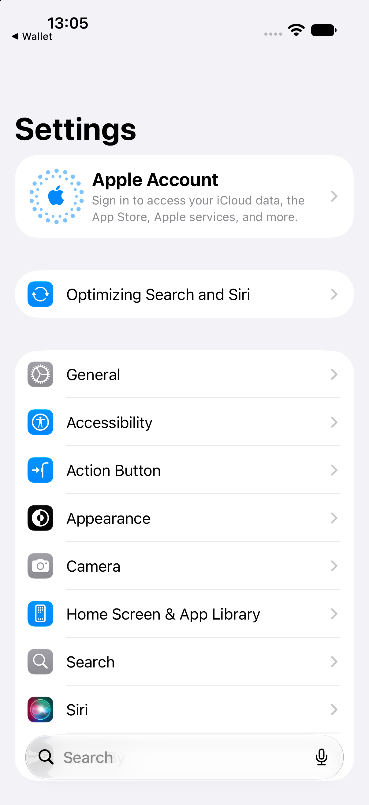
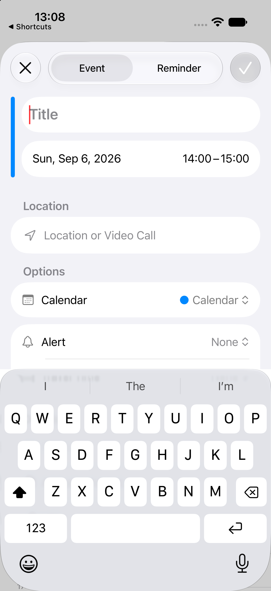

# iOS navigation and presentation patterns

## Large-title hierarchy

- **Pattern name:** [Observed] Large-title hierarchy.
- **Platform:** [Observed] iOS 27.0 Simulator.
- **Category:** [Observed] Navigation.
- **Description:** [Observed] A prominent page title sits above grouped content; a rounded back control replaces it on a pushed destination.
- **Purpose:** [Inferred] Preserve orientation while giving the current level strong visual priority.
- **Visual structure:** [Observed] Settings uses “Settings” over grouped rows and “General” over its detail groups; Files uses “Browse” over locations and tags.
- **Interaction:** [Observed] Tapping General pushed a General destination; tapping Browse changed Files from Recents to Browse.
- **States:** [Observed] Root, pushed destination, and empty destination were captured.
- **Variations:** [Observed] Settings presents a descriptive hero card on General, while Files keeps a compact centered location title inside On My iPhone.
- **Applications observed:** [Observed] Settings, Files, Shortcuts.
- **Screenshot evidence:** [Observed] , [Settings General](../../../../skills/native-ui-patterns/assets/ios/settings/general.png), [Files Browse](../../../../skills/native-ui-patterns/assets/ios/files/browse.png), [Shortcuts root](../../../../skills/native-ui-patterns/assets/ios/shortcuts/empty-library.png).
- **Design guidance:** [Inferred] Use the large title for the current information level and a visible back action for deeper levels.
- **Avoid:** [Inferred] Avoid presenting a new hierarchy level without a title or return path.
- **Notes:** [Unconfirmed] Interactive edge-swipe back behavior was not retained because the bounded automation run timed out before that test executed.

## Floating bottom navigation dock

- **Pattern name:** [Observed] Floating bottom navigation dock.
- **Platform:** [Observed] iOS 27.0 Simulator.
- **Category:** [Observed] Primary navigation.
- **Description:** [Observed] Primary destinations appear in a rounded translucent dock detached from the screen edge.
- **Purpose:** [Inferred] Keep major destinations reachable while leaving content visible around the control.
- **Visual structure:** [Observed] Files shows three labeled icon destinations; Photos shows two labeled destinations with a separate circular Search action.
- **Interaction:** [Observed] Selecting Browse in Files moved the highlighted state from Recents to Browse.
- **States:** [Observed] Selected destinations use blue icon/text and a tinted capsule; unselected destinations use dark icon/text.
- **Variations:** [Observed] Files contains all destinations in one dock; Photos separates Search into a circular trailing control.
- **Applications observed:** [Observed] Files, Photos.
- **Screenshot evidence:** [Observed] , [Files Browse selected](../../../../skills/native-ui-patterns/assets/ios/files/browse.png), [Photos Library](../../../../skills/native-ui-patterns/assets/ios/photos/library-notification-permission.png).
- **Design guidance:** [Inferred] Keep stable peer destinations together and make selected state redundant through color plus a containing shape.
- **Avoid:** [Inferred] Avoid using this control for transient commands that do not change destination.
- **Notes:** [Observed] Safari also showed a persistent rounded bottom toolbar, but it was not classified as the same pattern because its items are browser commands rather than peer destinations.

## Full-screen task surface

- **Pattern name:** [Observed] Full-screen task surface.
- **Platform:** [Observed] iOS 27.0 Simulator.
- **Category:** [Observed] Presentation.
- **Description:** [Observed] Editing is presented as a dedicated surface with a leading close control and trailing checkmark commit control.
- **Purpose:** [Inferred] Isolate a focused creation or editing task from the browsing context.
- **Visual structure:** [Observed] Calendar places an Event/Reminder segmented control between close and commit; Contacts places the controls above the contact avatar and grouped fields.
- **Interaction:** [Observed] Tapping Add in Calendar opened an event task surface; tapping Edit on a contact opened a contact task surface.
- **States:** [Observed] Calendar showed an empty focused Title field and a muted checkmark; Contacts displayed populated editable values.
- **Variations:** [Observed] Calendar focuses the title immediately; Contacts begins with existing values and add/remove row affordances.
- **Applications observed:** [Observed] Calendar, Contacts.
- **Screenshot evidence:** [Observed] , [Contacts edit form](../../../../skills/native-ui-patterns/assets/ios/contacts/edit-form.png).
- **Design guidance:** [Inferred] Pair an explicit dismissal action with a clearly separated commit action.
- **Avoid:** [Inferred] Avoid committing edits automatically when the user explicitly entered a task surface.
- **Notes:** [Observed] No values were entered and no edits were saved during inspection.
